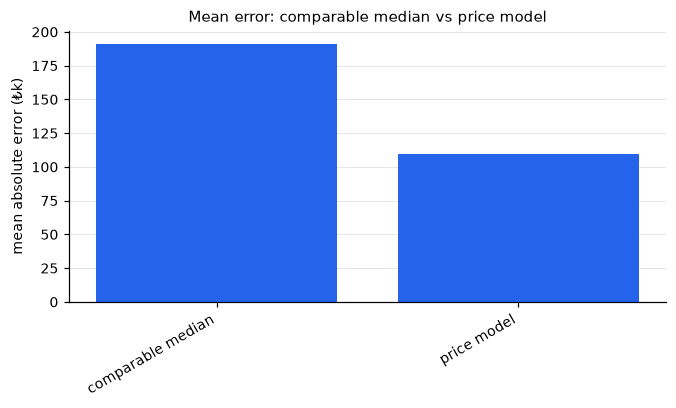
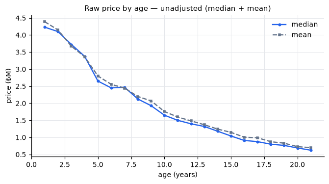
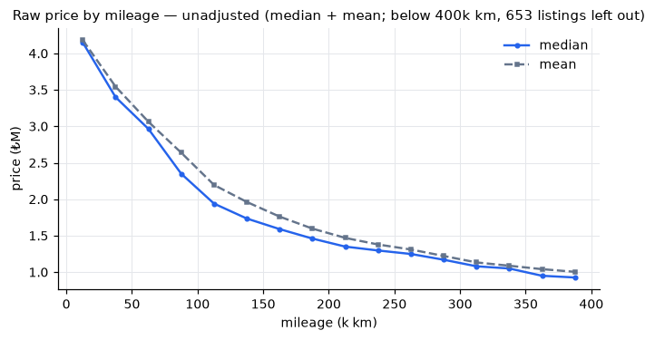
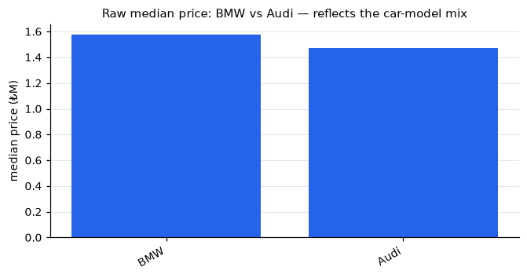
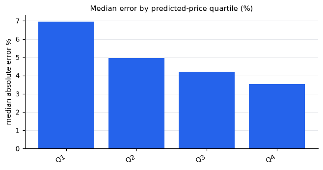
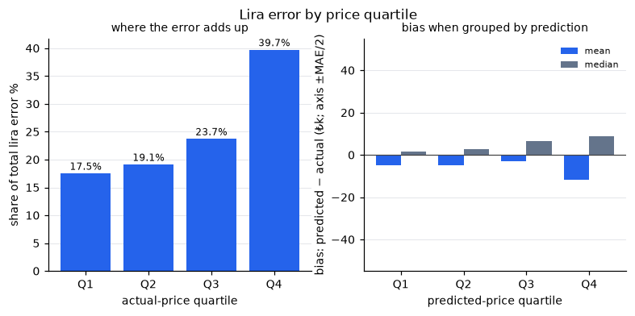
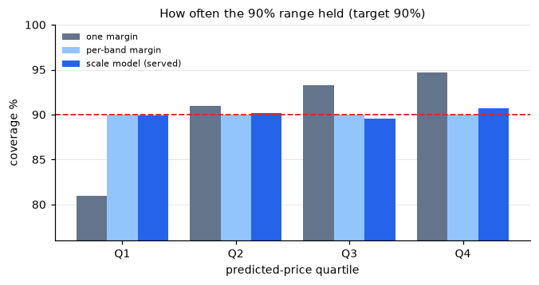

# Used Car Market Analysis — Decision Note

**For:** the pricing team and the dealership. **Decision:** the model can serve as the primary reference in a price-suggestion tool, but not on its own for cheap (estimated below ₺1.15M), comparable-less or old (roughly 18+) cars. **Gain:** about ₺81K less pricing error per car. **Limit:** it predicts the asking price, not the sale price.

## What's it worth?

**The comparable median** — *the middle price of the same car model and year; with no comparable that year, that car model's all-year median, and failing that the whole market's* — misses by **₺191K** on average; the price model by **₺110K** — **43% better**, **₺81K** per car. Across a 100-car stock that is about **₺8M** of pricing error. On the listings that do have a comparable (97.5%) the baseline misses by ₺179K and the price model by ₺106K: ₺73K per car, 41%.

Beyond car model and year the gap is closed mostly by mileage and damage: removing them from the price model grows the (root-mean-square) error by ₺55K and ₺25K respectively. The engine information is largely in the car model's name already: removing that group on its own adds only ₺524.

**Without a comparable the baseline collapses** — mean error at the bottom tier is **6.1×** the top. The price model struggles without comparables too — where, further down.

| baseline tier | listings | share | mean error |
|---|---:|---:|---:|
| car model + year | 29,236 | 97.49% | ₺179K |
| car model | 596 | 1.99% | ₺559K |
| global | 156 | 0.52% | ₺1.10M |

## How this market builds a price

What the car is and the state it is in set the price together. Of the (percentage) price differences between listings, the car's condition alone (age, mileage, damage, paint, changed panels) explains about 73%, the car model name alone 82%, and both together (with the engine) 96% (measured on listings left out of the fit).

The price difference between **otherwise similar listings of the same car model**:

| item | price |
|---|---:|
| age (per year, depending on age) | -4.7% to -6.8% |
| mileage (per 100k km, at a typical car) | -14.8% |
| heavy-damage record | -12.5% |
| changed panel (each) | -3.1% |
| painted panel (just one) | -2.3% |
| painted panels (5 or more, in total) | -7.0% |

Age and mileage are linked axes; every row is measured with the other held fixed. The mileage row is at a typical car (11 years, 181,000 km); the yearly effect of age changes with age. The data is one period: the age row is the price gap between two listings one model year apart, not how much one car will lose in a year. A painted panel is not a fixed amount each: the first costs the most, the later ones less.

**Brand gives you nothing to act on.** Adding brand on top of series and car model does not move the price model's mean error: brand already lives inside the car model.

## Where not to trust the number

In **percentage** terms the model struggles on cheap cars — error varies sharply by predicted-price quartile.

**In lira the picture flips.** The largest share of total lira error (38.9%) sits in Q4; mean absolute error is ₺171K in the most expensive quartile and ₺77K in the cheapest. The model is not noticeably biased in any predicted quartile: the slope of actual on predicted price is 1.003.

**The fewer the comparables, the higher the large-miss rate (beyond ±20%).** With no other listing of the same model and year the rate is 19.0%; with 100+ comparables 2.9%. Top/sport segments (19.1%) and cars aged 18 or older (12.0%) are risky too; overall 4.0%.

### Why a range, not a single number

An asking-price error costs money in both directions: **over-estimating hits the buyer** — they overpay; **under-estimating hits the seller** — the car goes too cheap. A single number hides how sure the estimate is; a range states it and warns the user exactly where uncertainty is large.

That is why the output is a **90% range**, not one number, and the range is per car: a small second model estimates how large the error usually is for this kind of car, and the margin opens to match. With the same margin for everyone the range did not hold in the cheapest predicted quartile (coverage **81.0%**) or on cars without a comparable (70.7%); with the per-car margin it is 89.9% in the cheapest quartile and 90.3% without a comparable. On the last snapshot's new listings (the model trained on the listings before it) it holds without a comparable too, at 88.5% (same margin for everyone: 68.3%). Across all new listings coverage is **86.8%**, not 90%: the numbers describe asking prices of January–June 2026.

Next to the range there is a hit probability: how often the asking price of this kind of car is within ±10% of the estimate, shown as "N in 10"; rounded down and at most 9, so "10 in 10" never appears. On new listings it is 4.0 points optimistic (predicted 79.1%, observed 75.1%).

**What to do**

- Show the price with its range: the margin comes per car, so the range widens by itself where uncertainty is large. Don't trust a point estimate; on new listings count on the range holding 86.8% of the time, not 90%.
- Price rare and edge cars by hand; the model scatters there.
- Review a listing whose text mentions a conversion, an engine swap or modifications before it goes live: that information is not in the form. With vehicle attributes held fixed no significant difference in its error rate was measured; the review guards against what the form cannot see, not against model error.

## What this model does not give you

- **The sale price.** It predicts the asking price; the sale price lands below it after haggling.
- **Causation.** These are controlled associations; it won't say "repaint it and the price drops".
- **The value of one specific damaged car.** The model sees damage at panel and panel-group level (painted · changed · heavy-damage record) but not its **severity**: a light scratch and a deep dent land on the same "painted" flag.
- **Equipment beyond the package, and modifications.** The trim package in the model name (M Sport, S Line and the like) is read; options outside the package and later changes are not visible.
- **Time.** The model learns the prices of the four snapshots together and does not see the period. On the last snapshot's new listings its error is 6.78%; the 6.49% above comes from a measurement that mixes the snapshots.
- **Anything outside BMW and Audi.** Scope is these two brands; how far it generalises to other brands was not measured.

**Scale:** 29,988 listings, 4 scrape snapshots. **Data:** 2026-01-18 – 2026-06-27. Median asking price ₺1.55M.
