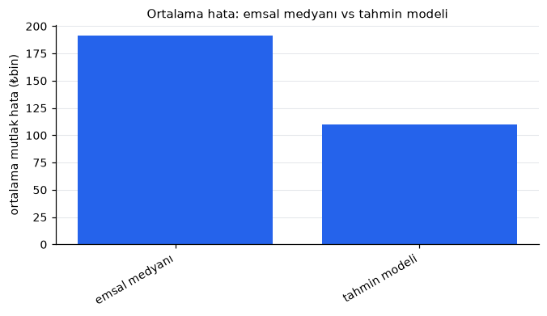
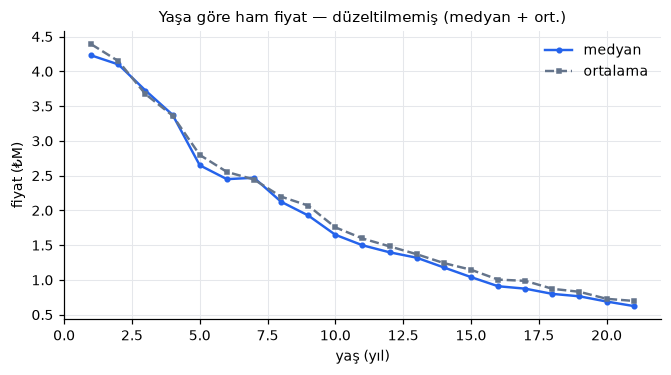
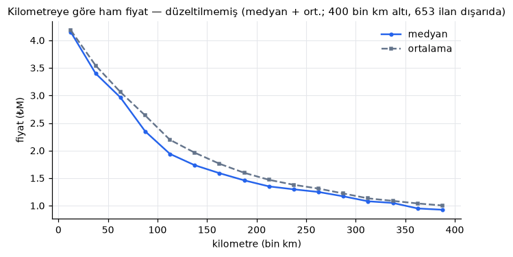
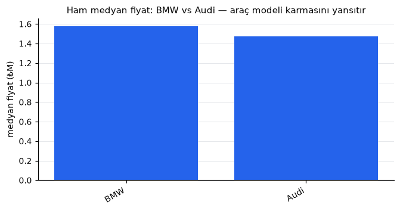
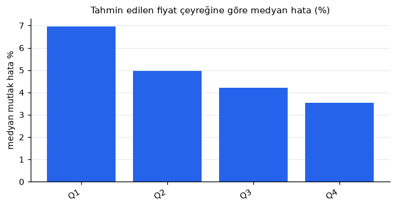
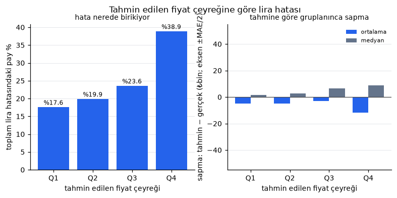
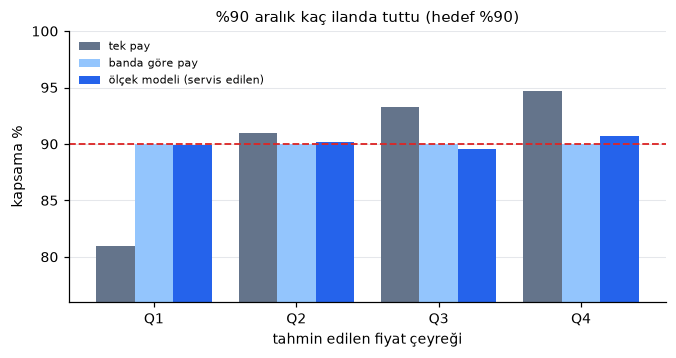

# İkinci El Araç Piyasası Analizi — Karar Notu

**Kime:** fiyatlama ekibi ve galeri. **Karar:** model, fiyat önerisi aracında birincil referans olarak kullanılabilir; ucuz (tahmini ₺1.15M altı), emsalsiz ve yaşlı (kabaca 18 yaş ve üstü) araçlarda tek başına kullanılmamalı. **Kazanç:** araç başına ~₺81K daha az fiyatlama hatası. **Sınır:** ilan fiyatını tahmin eder, satış fiyatını değil.

## Ne kadar değerinde?

**Emsal medyanı** — *aynı araç modeli ve yılın ortadaki fiyatı; o yıl için emsal yoksa o araç modelinin tüm yıllarının, o da yoksa bütün piyasanın medyanı* — ortalama **₺191K** yanılıyor; tahmin modeli **₺110K** — **%43 daha iyi**, araç başına **₺81K**. 100 araçlık bir stokta bu, yaklaşık **₺8M**'lik fiyatlama hatası farkı demek. Yalnız emsali olan ilanlarda (%97.5) karşılaştırınca taban ₺179K, tahmin modeli ₺106K: araç başına ₺73K, %41.

Farkı kapatan, araç modeli ve yılın ötesi en çok kilometre ve hasar: tahmin modelinden çıkarılınca hata (karesel ortalama) sırasıyla ₺55K ve ₺25K büyüyor. Motor bilgisi ise büyük ölçüde araç modelinin adında zaten var: ayrıca çıkarılınca hata yalnız ₺524 artıyor.

**Emsal yoksa taban çöküyor** — en alt basamakta ortalama hata, araç modeli + yıl basamağının **6.1 katı**. Tahmin modeli de emsalsiz araçta zorlanıyor — nerede, ileride.

| taban basamağı | ilan | pay | ortalama hata |
|---|---:|---:|---:|
| araç modeli + yıl | 29.236 | %97.49 | ₺179K |
| araç modeli | 596 | %1.99 | ₺559K |
| global | 156 | %0.52 | ₺1.10M |

## Piyasa fiyatı nasıl kuruyor

Aracın ne olduğu ve durumu fiyatı birlikte kuruyor. İlanlar arasındaki (yüzde olarak ölçülen) fiyat farklarının yaklaşık %73 kadarını yalnız aracın durumu (yaş, km, hasar, boya, değişen panel), %82 kadarını yalnız araç modelinin adı, %96 kadarını ikisi (motorla birlikte) açıklıyor (hesaba girmeyen ilanlarda ölçüldü).

**Aynı araç modelinin, başka her bakımdan benzer ilanları** arasındaki fiyat farkı:

| kalem | fiyat |
|---|---:|
| yaş (yıl başına, yaşa göre) | -%4.7 ile -%6.8 arası |
| kilometre (100 bin km başına, tipik araçta) | -%14.8 |
| ağır hasar kaydı | -%12.5 |
| değişen panel (her biri) | -%3.1 |
| boyalı panel (yalnız bir tane) | -%2.3 |
| boyalı panel (5 ve fazlası, toplam) | -%7.0 |

Yaş ve kilometre birbirine bağlı iki eksen; tablodaki her satır öteki sabitken ölçüldü. Km satırı tipik araçta (11 yaş, 181.000 km); yaşın yıllık etkisi yaşa göre değişiyor. Veri tek dönem: yaş satırı bir model yılı farklı iki ilanın fiyat farkı, bir aracın bir yılda ne kadar değer kaybedeceği değil. Boyalı panel her biri sabit bir tutar değil: ilki en çok düşürüyor, sonrakiler daha az.

**Markadan hareket çıkmaz.** Seri ve araç modelinin üzerine markayı eklemek tahmin modelinin ortalama hatasını hiç oynatmıyor: marka zaten araç modelinin içinde.

## Sayıya nerede güvenme

Model ucuz araçlarda **yüzde olarak** zorlanıyor — hata tahmin edilen fiyatın çeyreğine göre belirgin değişiyor.

**Liraya çevrilince tablo tersine dönüyor.** Toplam lira hatasının en büyük payı (%38.9) Q4'te; ortalama mutlak hata en pahalı çeyrekte ₺171K, en ucuzda ₺77K. Model hiçbir tahmin çeyreğinde belirgin yanlı değil: gerçek fiyat ile tahmin arasındaki eğim 1.003.

**Emsal azaldıkça büyük sapma (±%20 üstü) oranı artıyor.** Aynı model ve yıldan başka ilan yoksa bu oran %19.0, 100+ emsal varsa %2.9. Üst/spor segment (%19.1) ve 18 yaş ve üstü araçlar (%12.0) da riskli; genel oran %4.0.

### Neden tek sayı değil aralık

İlan fiyatında iki yönlü hata da para kaybettirir: **fazla tahmin alıcıya patlar** — pahalıya alınmış araç; **düşük tahmin satıcıya** — ucuza gitmiş araç. Tek sayı ne kadar emin olunduğunu saklar; aralık bunu söyler ve kullanıcıyı belirsizliğin büyük olduğu yerde uyarır.

Bu yüzden çıktı tek sayı değil, **%90 aralık**, ve aralık araca göre: küçük bir ikinci model bu tür araçta beklenen hatanın büyüklüğünü tahmin ediyor, pay ona göre açılıyor. Herkese aynı payla aralık tahmini en ucuz çeyrekte (kapsama **%81.0**) ve emsalsiz araçta (%70.7) tutmuyordu; araca göre payla en ucuz çeyrekte %89.9, emsalsiz araçta %90.3. Son taramanın yeni ilanlarında (model ondan önceki ilanlarla eğitildi) emsalsiz araçta da %88.5 tutuyor (herkese aynı payla %68.3). Yeni ilanların tamamında kapsama **%86.8**, %90 değil: sayılar Ocak–Haziran 2026 ilan fiyatlarını anlatır.

Aralığın yanında bir isabet olasılığı da var: bu tür araçta ilan fiyatının tahminin ±%10 yakınında olma sıklığı, "10'da N" olarak; aşağı yuvarlanır ve en çok 9, "10'da 10" hiç gösterilmez. Yeni ilanlarda 4.0 puan iyimser (öngörülen %79.1, gerçekleşen %75.1).

**Ne yapmalı**

- Fiyatı aralığıyla birlikte göster: pay araca göre geldiği için belirsizliğin büyük olduğu araçta aralık kendiliğinden genişliyor. Tek sayıya güvenme; yeni ilanlarda aralığın %90 değil %86.8 tuttuğunu hesaba kat.
- Nadir ve uç araçları elle fiyatla; model orada saçılıyor.
- Metninde dönüşüm, motor değişimi ya da modifiye geçen ilanı yayına almadan önce gözden geçir: bu bilgi formda yok. Araç özellikleri sabitken bu ilanlarda hata oranında anlamlı bir fark ölçülmedi; gözden geçirme model hatasına değil, formun göremediği bilgiye karşı.

## Bu model neyi vermez

- **Satış fiyatını.** İlan fiyatını tahmin eder; satış fiyatı pazarlıkla bunun altına iner.
- **Nedenselliği.** Bunlar kontrollü ilişkiler; "boya yaptır, fiyat düşer" demez.
- **Belirli bir hasarlının değerini.** Model hasarı panel ve panel grubu düzeyinde görüyor (boyalı · değişen · ağır hasar kaydı) ama **şiddetini** görmüyor: hafif bir çizik de derin bir göçük de aynı "boyalı" bayrağına düşüyor.
- **Paketin ötesindeki donanımı ve modifiyeyi.** Model adındaki donanım paketi (M Sport, S Line gibi) okunuyor; paketin dışındaki opsiyonlar ve sonradan yapılan değişiklikler görünmüyor.
- **Zamanı.** Model dört taramanın fiyatlarını birlikte öğrenir, dönem farkını görmez. Son taramada yeni ilanlardaki hatası %6.78; yukarıdaki %6.49 taramaları karıştıran ölçümden.
- **BMW ve Audi dışını.** Kapsam bu iki marka; başka markalara ne kadar genellenebildiği ölçülmedi.

**Ölçek:** 29.988 ilan, 4 tarama dönemi. **Veri:** 2026-01-18 – 2026-06-27. Medyan ilan fiyatı ₺1.55M.
