# Used Car Market Analysis — Technical Report

This report answers two questions: what sets a used-car price, and how accurately the model can predict it. The analysis runs over **29,988** Turkish-plated BMW/Audi listings — from cleaning and leakage checks through controlled price effects, market structure, model comparison and a forward test on new listings. LightGBM is off by **6.49%** on average (MAE: **₺110K**, R²: **0.9745**), with a **43%** lower mean absolute error than the comparable median (same car model and year, falling back to a wider median when there is none). The headline metrics are computed **5-fold out-of-fold**, on data the model never saw in training; the forward test is in §8. The target is the asking price, not the sale price: the sale price moves away from it through bargaining.

## 1. Data cleaning and leakage detection

**45,159 TR-plated snapshot rows → 29,988 listings.** The 15,171 other rows are the same ad seen again in later snapshots; the latest record per `ad_id` is kept. The repeats carry information the model does not use: of the 10,831 listings seen in more than one snapshot, 4,703 changed price (2,801 cuts, 1,854 rises; 48 went back to their earlier price).

Median asking price ₺1.55M, ranging ₺0.85M–₺3.43M (P10–P90).

**Scope: Turkish-plated vehicles only.** 22 blue-plate listings (cars of foreign residents) were not taken into the model or the analysis: their tax regime differs and would mislead the model and the analysis. The 54 listings with an empty plate field were not taken in either, since their regime is unknown.

**Scope: collection filters.** The data was collected from Audi and BMW listings in the site's "otomobil" category with these filters: price ₺300K–₺6.50M, at most 700,000 km, model year 2005 or later, fuel Petrol, Diesel, Hybrid, LPG. Three consequences:

- **Price is right-truncated.** The most expensive listing sits exactly at the cap (₺6.50M); 10 listings are at the cap and none above it. Cars above the cap are not in the data; predictions at the expensive end should be read with that limit in mind.
- **Age is at most 21.** Model year 2005 holds 541 listings; older cars were not collected, so the oldest bucket runs into the collection limit.
- **Body and fuel.** Only the "otomobil" category was collected, not the others: the data holds 6 SUVs. The fuel filter leaves electric cars out: 0 electric listings.

### Preprocessing and filters

Before the model, these steps were applied to the collected data, in this order:

1. **Plate:** only Turkish-plated rows were taken: 45,159 of 45,315 snapshot rows. 22 blue-plate listings and 54 with an empty plate field were left out entirely (reason above).
2. **Deduplication:** the latest snapshot per `ad_id`: 45,159 rows → 29,988 listings.
3. **"Unspecified" = none:** an unspecified panel counts as original, an unspecified heavy-damage record as not heavily damaged (below).
4. **Engine range → one number:** size is the range's upper bound, power the mean of the lower and upper bounds (below).
5. **Damage:** 39 raw panel flags were reduced to 12 features (below).
6. **Missing values:** no filling in the numeric features, an empty value reaches the model empty; an empty category becomes its own `missing` category (below).
7. **No outliers removed:** price, km and age were not trimmed; every Turkish-plated listing is in the model.
8. **Target:** `log1p(price)`.

### Scale

| item | value |
|---|---:|
| TR-plated snapshot rows (all snapshots) | 45,159 |
| unique listings (`ad_id` dedup) | 29,988 |
| snapshots | 4 (2026-01-18 – 2026-06-27) |
| raw columns (feed) | 117 |
| model features | 25 |
| BMW / Audi | 17,896 / 12,092 |
| target | `log1p(price)` |

### Three data layers

1. **Structural** — age · km · engine power/size · body · fuel · transmission · drivetrain · segment.
2. **Damage / inspection** — 13 body panels × {changed, painted, local paint} + the heavy-damage record. Those 39 raw flags reach the model as 12 features: roof · hood · trunk are single panels, so they carry a **state** (original/local/painted/changed), while door · fender · bumper carry a within-group **count** (doors 0–4, fenders 0–4, bumpers 0–2).
3. **Free text** — the seller's description; **not used** by the model. It was measured: it adds 0.0008 to log R²; the detail is in §9.

**"Unspecified" panels were counted as original.** The site gives one of five answers per panel: original, unspecified, painted, locally painted, changed. Across the listings in the model 59,651 panels (15.3%) are unspecified; on 1,235 listings all 13 are. That answer was coded as original by a deliberate decision, on the reasoning that the seller may have forgotten to list damage but no damage is the likelier case.

**The heavy-damage record follows the same rule.** On 68.2% of the listings in the model the page gives no heavy-damage answer ("Belirtilmemiş" or no field); those listings count as not heavily damaged. A heavily damaged car whose listing does not say so looks free of heavy damage to the model.

### Engine power and size: from a range to one number

On some listings the site gives engine size and power as an exact value, on others as a **range**: among the listings in the model, 7,865 have engine size and 7,797 have power as a range (the most common are 1401–1600 cc and 151–175 hp). The model uses one number. The rule: **size = the range's upper bound, power = the mean of the lower and upper bounds** (the known bound for an open-ended range). The rule was checked against the data: each range listing's three candidates were compared with the median of the same model's exact-value listings — 7,176 listings for size, 7,148 for power (models that have at least one exact listing).

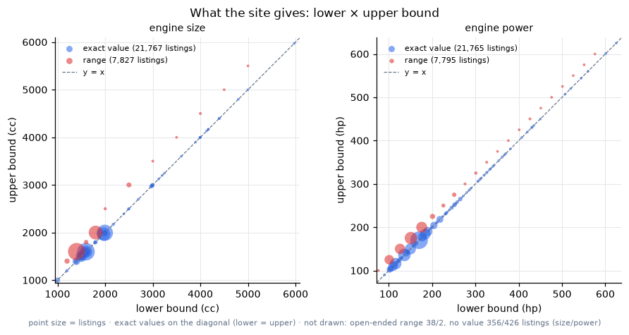

Example: a listing given as 1401–1600 cc belongs to a model whose exact-value listings most often say 1598 cc; for this listing the candidates are the lower bound 1401 (197 cc away), the midpoint 1500.5 (97.5 cc) and the upper bound 1600 (2 cc). The number in the table below is the median of these gaps over all range listings; each model's reference is the median of its own exact-value listings.

| candidate | size: median absolute gap | power: median absolute gap |
|---|---:|---:|
| lower bound | 194 cc | 17 hp |
| midpoint | 95.5 cc | **7 hp** |
| upper bound | **5 cc** | 14 hp |

For size the exact value sits right at the top of the range (median position within the range 97.5%, lower quartile 83.9%; the most common exact value among the models in the most common range is 1598 cc), so the upper bound is almost a direct hit; in every range with at least 100 listings (5/5) the upper bound is the closest candidate. For power the closest candidate changes with the power level (ranges with at least 100 listings): 101–125 hp midpoint; 126–175 hp upper bound; 176–225 hp lower bound; 226–250 hp lower bound and midpoint tied; 251–275 hp lower bound. So the exact value's position within the range is spread out (quartiles 29.2%–79.2%). As a single rule the midpoint has the smallest median gap over all range listings. The same model's median exact value falls inside the range for 97.9% of listings on size and 84.2% on power; among the power listings outside it, models with more than one exact power value make up 90.3% — one model name covers several engine options, so this share reflects a coarse reference, not wrong ranges on the site. If the rule stops matching the data (the chosen candidate no longer has the smallest median gap), the generator stops.

The reason is the engine's litre label: an engine sold as "1.6" really displaces about 1598 cc, a few cc below the label. The site's ranges end at those label values (1401–1600 cc), so the real size almost always sits very close to the range's upper bound. Power has no such label; the real values spread across the range, and there the midpoint fits better.

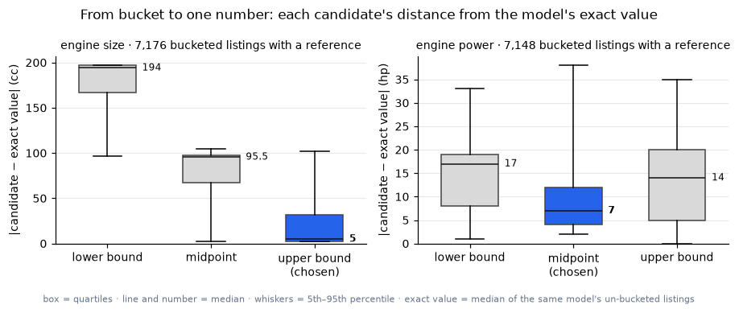

### Kept features (25)

Model (`model`) · Series (`series`) · Brand (`brand`) · Body Type (`kb_body_type`) · Drivetrain (`kb_drivetrain`) · Segment (`segment`) — derived from series and model name · Transmission (`kb_transmission`) · Fuel Type (`kb_fuel`) · Roof State (`roof_state`) · Hood State (`hood_state`) · Trunk State (`trunk_state`) · Age (years) (`vehicle_age`) · Mileage (`gb_mileage`) · Power (hp) (`power_hp_val`) · Engine (cc) (`engine_cc_val`) · Door Changed (`door_changed`) · Door Painted (`door_painted`) · Door Local Paint (`door_local`) · Fender Changed (`fender_changed`) · Fender Painted (`fender_painted`) · Fender Local Paint (`fender_local`) · Bumper Changed (`bumper_changed`) · Bumper Painted (`bumper_painted`) · Bumper Local Paint (`bumper_local`) · Heavy Damaged (`is_heavy_damaged`)

### Dropped feature groups

Of the 117 raw columns, 53 reach the model directly or derived (39 of them damage flags), one is the target (price) and 63 were dropped. Every raw column is assigned to exactly one class below; the table is computed from the code.

| group | reason | cols | columns |
|---|---|---:|---|
| C | Identity / text / time | 8 | `ad_id`, `listing_date`, `ad_title`, `location`, `eids_model`, `url` … |
| F | Derived duplicate | 9 | `engine_cc_low`, `engine_cc_val`, `engine_cc_is_range`, `power_hp_val`, `power_hp_is_range`, `count_changed` … |
| B | kb/gb twin | 11 | `kb_year`, `kb_mileage`, `gb_transmission`, `gb_fuel`, `gb_body_type`, `gb_color` … |
| A | Quasi-constant (top value ≥ 99%) | 4 | `kb_condition`, `gb_usage_type`, `gb_is_first_owner`, `gb_plate_origin` |
| D | Missing > 40% | 5 | `gb_mtv_yearly`, `tramer_fee`, `transmission_brand`, `gb_kasko_avg`, `gb_traffic_insurance_avg` |
| E | Catalogue block (co-missing) | 22 | `kb_fuel_cons_avg`, `kb_fuel_tank`, `gb_segment`, `torque_nm`, `cylinder_count`, `max_speed_kmh` … |
| G | Not in the model, no recorded reason | 4 | `kb_color`, `kb_trade_available`, `kb_seller_type`, `gb_warranty_status` |

*`engine_cc_val`, `power_hp_val`: the database columns (the range midpoint). The model re-derives both from the lower and upper bounds (engine rule above): for power the mean of the bounds, i.e. the same value as the database column; for size the upper bound, i.e. different from the database on range listings.*

Numeric features are not imputed: missing values reach LightGBM and CatBoost as NaN and the libraries' own missing-value routing handles them; missing categoricals become their own `missing` level. Only KMeans/PCA use a global-median fill; `torque_nm`, missing in 27.6% of listings, was dropped.

**Leakage control.** Dedup runs on `ad_id`, before the CV split. Evaluation is 5-fold out-of-fold: every listing is predicted exactly once, by a model that never saw it.

### Content-based duplication

| definition | excess rows | share |
|---|---:|---:|
| strict — every distinguishing field identical | 137 | 0.46% |
| loose | 209 | 0.70% |
| strict without price | 1,278 | 4.26% |

The risk `ad_id` cannot see: different `ad_id`, same car. The strict definition finds 127 duplicate groups; its columns: `price`, `gb_mileage`, `gb_year`, `brand`, `series`, `model`, `kb_fuel`, `is_heavy_damaged`, `count_painted`, `count_changed`, `power_hp_up`, `engine_cc_up`. Some are genuine re-posts, some coincidental matches on common models. The first two definitions require the same price, so they cannot see a listing re-posted at a new price. The strict definition without price finds 1,278 excess rows (4.26%); how many of those are re-posts at a new price and how many coincidental matches on common models cannot be told apart from the data. By these two definitions the share that could leak across folds is between 0.46% (strict) and 4.26% (without price); neither can see a re-post whose mileage was changed too.

Most repeated listings:

| model | year | price | repeats |
|---|---:|---:|---:|
| 320i Sport Line | 2025 | ₺4,900,000 | 4 |
| 318i Standart | 2005 | ₺717,000 | 3 |
| A3 Sportback 1.6 Ambition | 2010 | ₺890,000 | 3 |
| 116d Joy Plus | 2015 | ₺1,044,950 | 3 |
| 320i First Edition Sport Line | 2019 | ₺2,530,000 | 3 |

## 2. Missingness isn't random

32 columns are over 2% missing. 22 of them sit in four blocks that drop **together**: this isn't "missing data", it's listings where catalog matching collapsed — standard models match, niche variants don't, and all their specs go blank at once. Because it is systematic, reliable imputation is impossible → dropped. The other 10 columns are missing for other reasons and each was dropped in its own class (§1 table) — missing > 40%: `tramer_fee`, `transmission_brand`, `gb_traffic_insurance_avg`, `gb_kasko_avg`, `gb_mtv_yearly` · kb/gb twin: `gb_drivetrain`, `gb_trade_available` · not in the model, no recorded reason: `gb_warranty_status`, `kb_trade_available` · identity / text / time: `eids_model`.

Missingness is not an issue in the 25 features that remain: the worst is `kb_drivetrain` at 1.5% and 21 have none at all. The chart above covers only the dropped columns.

**"Unspecified" is not missing data.** What the page does not say stays empty in the data. In 45 columns that gap is not missing data but the seller's "unspecified" answer; these columns are kept out of the list and the blocks above. The heavy-damage record is unspecified on 68.2% of the listings, and each of the 39 panel flags on 12.2%–19.1%. The model reads these unknowns as "no" by a deliberate decision: an unspecified panel counts as original, an unspecified heavy-damage record as not heavily damaged (§1).

### Co-missing blocks

| cols | avg missing | missing together | example columns |
|---:|---:|---:|---|
| 16 | 27.6% | 98.8% | `weight_kg`, `kb_fuel_cons_avg`, `kb_fuel_tank`, `gb_segment` … |
| 2 | 31.4% | 100.0% | `city_fuel_cons`, `highway_fuel_cons` |
| 2 | 29.9% | 100.0% | `production_year_start`, `production_year_end` |
| 2 | 29.3% | 100.0% | `rpm_max`, `rpm_min` |

*Missing together: listings where every column of the block is missing, as a share of listings where at least one is.*

### gb_ / kb_ dual source

| field | Overview (gb) empty | QuickInfo (kb) twin |
|---|---:|---|
| Drivetrain (`gb_drivetrain`) | 74.0% | `kb_drivetrain` · missing 1.5% |
| Avg. Traffic Insurance (`gb_traffic_insurance_avg`) | 54.3% | none |
| Avg. Casco Insurance (`gb_kasko_avg`) | 51.1% | none |
| Annual Vehicle Tax (`gb_mtv_yearly`) | 40.6% | none |

**kb/gb.** The same field can appear in two tabs of a listing page: `kb` is quick info, `gb` the overview. In 8 of the 10 pairs the two tabs are identical. In 6 pairs one side is in the model and the other was dropped; in 4 pairs (`color`, `condition`, `trade_available`, `seller_type`) neither side is in the model. The twin class in the §1 table holds one more column: `kb_is_heavy_damaged`, identical to `is_heavy_damaged`. For drivetrain `gb` is empty on 74.0% of listings, `kb` on 1.5%. **For body type `kb` was chosen because it is more general:** 9 categories, while `gb` merges the same information with the seat count into 23 values. The 3 fields with no counterpart and over 40% empty (Avg. Traffic Insurance, Avg. Casco Insurance, Annual Vehicle Tax) were dropped.

## 3. Redundancy, dependence and brand

Theil's U(a | b) gives how much of a's uncertainty is gone once b is known (0–1), and it is directional. The asymmetry is the finding: `model` almost fully determines `brand`, `segment`, `series` (U ≥ 0.99) but not vice-versa — `series` is a coarsened view of `model`, not independent information.

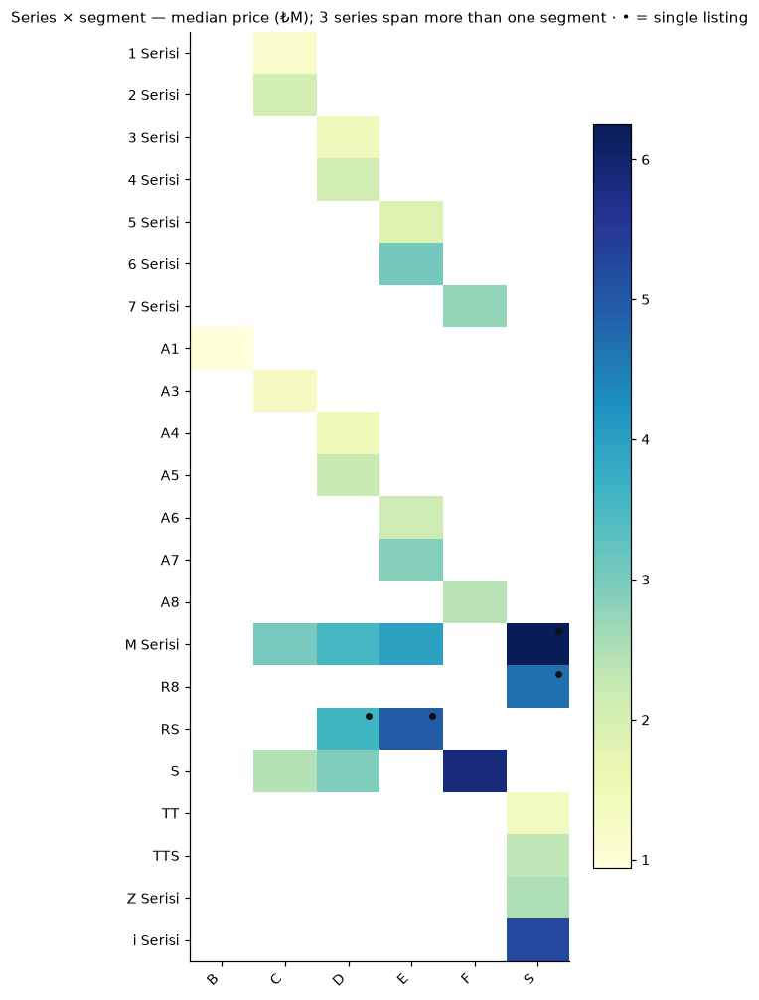

In the other direction series determines model only at 0.39. Brand is fully readable from either model or series (U(brand | model) = 1.00): brand carries no separate information; the brand ablation below measures the same thing.

Spearman correlation (rank association) among the numeric features, in the map below. Pairs with |ρ| > 0.5: Age (years)–Mileage 0.74, Power (hp)–Engine (cc) 0.61, Door Painted–Fender Painted 0.60. Collinearity in the hedonic regression is measured with VIF in §6; door and fender paint enter there as the total painted-part count, not separately.

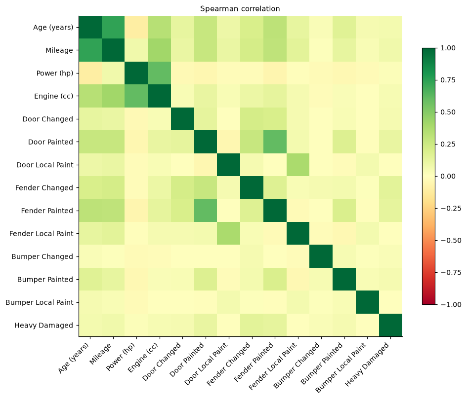

### Segment is derived, not fed

The raw `gb_segment` is not used, and missingness is not the only reason: the feed's "G" segment is not a real segment. Of the 215 listings carrying that label, 214 have an MPV body and all come from one series — a corrupt source. Segment is therefore derived, with the MPV signal kept in body type.

29,832 listings take their segment straight from the series. In some families (`M Serisi`, `RS`, `S`, `i Serisi`) the segment is resolved from the model name, not the series — e.g. M3 → 3 Series, S3 → A3 — 156 listings in all. So segment is a function of (series, model), not series alone: U(segment | series) = 0.997, not exactly 1. If any series or model cannot be resolved the generator stops; there is no silent default segment.

The derived label differs from the feed on 404 of the 21,723 listings that have a raw segment (1.9%); 215 of those are the deliberate G fix, and the next largest source is 95 listings the feed calls E and the derivation calls D.

### Brand ablation

| identity columns | MAPE | MAE | R² |
|---|---:|---:|---:|
| brand only | 8.80% | ₺163K | 0.9413 |
| series + model | 6.49% | ₺110K | 0.9745 |
| brand + series + model (the report's model) | 6.49% | ₺110K | 0.9745 |

Only the identity columns change in the full model, everything else fixed; same 5-fold OOF. The "brand only" arm also drops segment, because segment is derived from series. Giving brand alone instead of series+model worsens MAE by ₺53K. Adding brand on top of series+model changes MAE by ₺1 (MAPE delta 0.00 pts) — across the headline model's 5 folds brand is used in 26 splits but does not change the error. This is the data's definition more than a measurement: every series here belongs to one brand (U(brand | series) = 1.00), so brand can be read off the series.

## 4. Target and preprocessing

Raw price is right-skewed (skew 1.62); a log transform pulls it toward symmetry (0.28). The model trains on `log1p(price)`: on the log scale a difference is a relative (percentage) difference, so the same percentage error weighs the same on a cheap and an expensive car. A modelling decision, not a market finding.

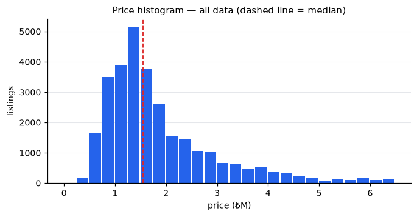

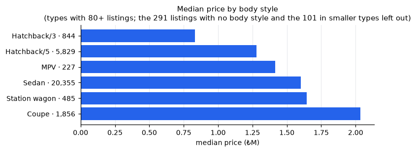

## 5. Market structure — no clear clusters

The data has no clear natural clusters: on the standardised numeric features KMeans stays below a silhouette of 0.25 for all seven values of k tried (2–8; the highest is k=2, 0.242). Clusters and PCA are therefore not used in the analysis; market structure is read through explicit features such as segment and body type.

## 6. Hedonic regression: identity and condition

This section answers two questions. First: how much of log price is explained by the car's condition alone, without knowing what car it is; how much by its identity alone (the car model name); and how much by both together. Second: with the car's identity held fixed, how its condition relates to the price, and how each effect changes once the identity is held fixed. The method is a hedonic regression (OLS; target log price, n **29,554**). It is used here not to predict prices but for the second question; predicting the price is the job of the price model in §7.

**Note:** The hedonic regression is an OLS and cannot run with missing values, so listings with missing engine power (426) or missing displacement (356) were removed before the analysis. Once the rows missing both are counted only once, 434 rows in total were dropped from the dataset.

### What explains the price

Six regressions on the same 29,554 listings. R² is on log price and out of fold: the listings were split into folds and each fold's listings were predicted by the regression fitted on the other folds. The last row is the price model's out-of-fold R² on the same scale.

| regression | columns (incl. intercept) | R² (out of fold) |
|---|---:|---:|
| segment, brand, fuel, transmission only | 12 | 0.3785 |
| the car model name only | 735 | 0.8220 |
| condition only: age, mileage, heavy damage, painted and changed panels | 9 | 0.7309 |
| condition + engine power and displacement | 11 | 0.8719 |
| condition + engine + segment, brand, fuel, transmission (**segment control**) | 22 | 0.9310 |
| segment control + the car model name (**car-model control**) | 756 | 0.9610 |
| **price model** (LightGBM) | – | 0.9699 |

Condition alone gives R² 0.7309, the car model name alone 0.8220, both together (car-model control, with the engine and the other identity dummies) 0.9610. The part only condition adds (car-model control minus the car model name alone) is 0.1390; the part only the car's identity adds (car-model control minus condition alone; the engine counts on the identity side here) is 0.2301; the remaining 0.5919 is shared: condition and identity are not independent, and either one alone explains this part.

The car model name closes about 77% of the gap left between segment control and the price model (0.9310 → 0.9699), taking it to 0.9610. The price model's R² is over all 29,988 listings, the regressions' over the 29,554 with an engine value. In-sample R² exceeds the out-of-fold one most for the car model name alone (0.8475): for car models with few listings the dummy fits its own listings and holds less well on listings it has not seen, which is why the table gives out-of-fold R². The price model's headline R² (0.9745) is on the raw ₺ scale and should not be read against the regressions.

### Effects with the identity held fixed

The same ten terms in three columns. **No identity:** the terms alone. **Segment control:** segment, brand, fuel and transmission dummies are added. **Car-model control:** the car model name is added to those (735 car models), so each effect is measured within one car model. The intervals come from standard errors clustered by car model (below).

| term | no identity [95% CI] | segment control [95% CI] | car-model control [95% CI] |
|---|---:|---:|---:|
| age | -7.04% [-7.62%, -6.46%] | -6.64% [-6.92%, -6.37%] | -5.80% [-6.33%, -5.27%] |
| age² | +0.03% [-0.05%, +0.11%] | +0.08% [+0.04%, +0.13%] | +0.03% [-0.03%, +0.08%] |
| km (100k) | -10.16% [-11.88%, -8.41%] | -15.11% [-15.81%, -14.40%] | -14.83% [-15.31%, -14.34%] |
| km² | +1.15% [+0.58%, +1.71%] | +1.56% [+1.08%, +2.05%] | +1.67% [+1.34%, +2.01%] |
| age×km | -0.39% [-0.73%, -0.05%] | -0.62% [-0.89%, -0.35%] | -0.33% [-0.56%, -0.10%] |
| heavy damage | -12.83% [-13.84%, -11.81%] | -11.60% [-12.51%, -10.68%] | -12.46% [-13.25%, -11.67%] |
| painted | -1.21% [-1.37%, -1.06%] | -1.05% [-1.17%, -0.92%] | -0.98% [-1.09%, -0.88%] |
| changed | -3.53% [-3.84%, -3.22%] | -3.06% [-3.33%, -2.79%] | -3.12% [-3.35%, -2.88%] |
| +100 hp | +50.15% [+39.36%, +61.78%] | +19.86% [+13.89%, +26.15%] | +19.30% [+6.90%, +33.12%] |
| +1 litre | +11.66% [+1.72%, +22.57%] | +7.49% [+0.71%, +14.73%] | +5.97% [-0.92%, +13.35%] |

Effect = exp(β)−1. Age and km are centred on the **median car** (11 years, 181,000 km): the age and km rows are the marginal effect at that car. Squared and interaction terms (age², km², age×km) are not read alone; they carry the curvature. The difference between the segment-control and car-model-control columns was tested per term with SEs clustered by car model: it exceeds sampling error (at 5%) for age, age×km, heavy damage, painted, and not for the other terms. The decision note's mileage, heavy-damage and changed-panel effects come from the car-model-control column; age and painted panels come from the two tables below, also within one car model.

The two terms that change most clearly once the identity is held fixed are mileage and +100 hp: only for these two does the no-identity interval overlap neither of the other two columns'. **Mileage** looks much weaker without the identity: km (100k) is -10.16% [-11.88%, -8.41%] without it and -14.83% [-15.31%, -14.34%] within one car model. Mileage and the car's identity move together: among listings with the same age, damage and engine, those with more mileage come on average from higher-priced car models. The coefficient without identity carries that too, so it understates how mileage relates to price. **+100 hp**, on the other hand, looks much larger without the identity: +50.15% [+39.36%, +61.78%]; +19.86% [+13.89%, +26.15%] under segment control and +19.30% [+6.90%, +33.12%] under car-model control. On the log scale more than half of the uncontrolled effect goes once segment, brand, fuel and transmission enter: most of it is the car's class, not the engine itself. There is no per-term difference test between the no-identity column and the other two; these two observations rest on the intervals not overlapping.

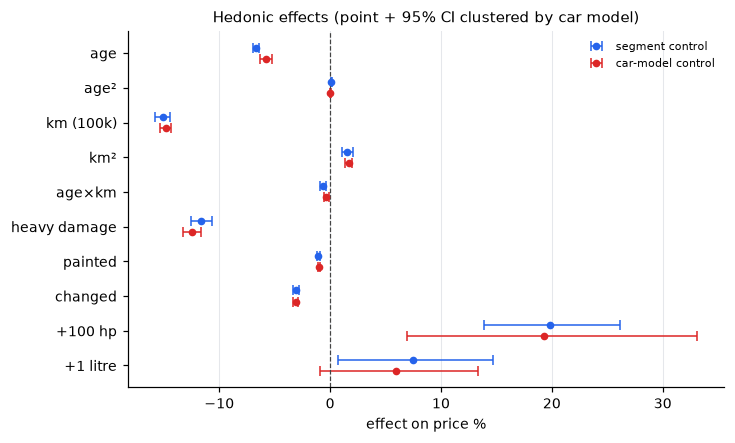

**Confidence intervals.** Listings of the same car model are not independent and the error variance is not equal (Breusch-Pagan p <0.001), so the 95% intervals come from standard errors clustered by car model (735 clusters). Terms whose interval contains zero: age² in the no-identity column; none under segment control; age², +1 litre under car-model control. Sensitivity: clustered by series (22 clusters; few and uneven, so for comparison only), the terms whose interval contains zero are +1 litre under segment control and age², age×km, +1 litre under car-model control. Car models of one series are not independent either; these terms' significance depends on the clustering.

**The coefficients are controlled associations, not causal effects.** E.g. the painted-panel coefficient does not say that painting lowers the price, only that listings with painted panels are advertised that much cheaper than similar ones.

**Collinearity.** The highest VIF in the segment-control column's design is age×km 7.25 (below 10); in the uncentred design the highest is age×km 96.28. Age, age², km, km² and age×km are built from two variables, so they are structurally linked; centring on the median car removes that, and predictions and R² do not change.

### Age: yearly steps

Here age enters as one dummy per age instead of a quadratic, and mileage as a flexible curve (B-spline, 6 degrees of freedom); the other terms and the car-model control stay. The table gives the average price change per year between two ages.

| age | listings in the range | per year [95% CI] |
|---|---:|---:|
| 1–5 | 4,812 | -5.51% [-6.73%, -4.28%] |
| 5–10 | 9,430 | -6.82% [-7.81%, -5.83%] |
| 10–15 | 15,533 | -6.14% [-7.32%, -4.94%] |
| 15–20 | 5,204 | -4.69% [-6.06%, -3.31%] |

The quadratic gives one number at the median car (11 years): -5.80% [-6.33%, -5.27%] a year. With yearly steps the drop runs from 4.69% to 6.82% a year depending on age (steepest from 5 to 10, slowest from 15 to 20); 2 of the 4 steps fall outside that single number's interval. The single number depends on the functional form chosen; it folds a drop that changes with age into one rate. The data is one period (January–June 2026): what is measured is the price difference between cars one model year apart listed at the same time, not how much one car loses as it ages.

### Painted and changed panels by count

Here the painted (changed) panel count enters as one dummy per count instead of a linear term; the effect is against listings with no painted (changed) panel, within one car model, the other terms held fixed. The last row is 5 or more.

| panels | painted: listings | painted [95% CI] | changed: listings | changed [95% CI] |
|---|---:|---:|---:|---:|
| 1 | 4,050 | -2.29% [-2.62%, -1.96%] | 4,638 | -3.70% [-4.03%, -3.37%] |
| 2 | 2,978 | -3.57% [-3.99%, -3.15%] | 2,276 | -6.38% [-6.93%, -5.83%] |
| 3 | 2,022 | -4.21% [-4.74%, -3.67%] | 856 | -9.32% [-10.09%, -8.54%] |
| 4 | 1,439 | -5.18% [-5.77%, -4.59%] | 258 | -11.72% [-13.23%, -10.19%] |
| 5 or more | 2,867 | -7.01% [-7.65%, -6.37%] | 82 | -11.05% [-15.33%, -6.55%] |

**A painted panel is not a fixed amount each.** One painted panel is -2.29% [-2.62%, -1.96%]; the linear term's per-panel coefficient is -0.98% [-1.09%, -0.88%], and the two intervals do not overlap. 5 or more is -7.01% [-7.65%, -6.37%]: if the first panel's effect repeated for every panel, 5 panels would be -10.94%, which the interval also excludes. The first painted panel costs the most; the later ones less on average. **Changed panels are close to linear:** -3.12% per panel, compounded by the count, falls inside every row's interval from 2 to 5 or more; only the first changed panel (-3.70% [-4.03%, -3.37%]) costs more than that.

### Engine effect

+100 hp is **+19.9%** under segment control and **+19.3%** under car-model control; +1 litre **+7.5%** and **+6.0%** (same regression, the other held fixed). The car model name largely fixes the engine, so under car-model control the engine terms are measured only from power and size differences within one car model; that is why their intervals are wider. That variation is thin: power varies across listings in only 354 of 735 car models (within-car-model standard deviation 9.0 hp, 43.1 hp overall), and part of it is catalogue error: without the listings with an inconsistent engine value (§8 counts 15; 14 of them are in the hedonic sample, the other 1 has no valid power or size value and was never in it) the car-model-control +100 hp goes +19.3% → +26.0%. Size and power are linked (Pearson correlation 0.73): size's effect is what remains with power fixed, so read the two coefficients together; the units differ, so they are not directly comparable.

### LOFO — leave-one-feature-out

LOFO is a second, independent method: drop each feature and measure how much CV error grows. It measures something different from SHAP — the part the remaining features cannot make up for. The ranking does not match SHAP's: LOFO gives Mileage > Age (years) > damage group > model/series name > engine (hp + cc); SHAP Age (years) > engine (hp + cc) > Mileage > model/series name > damage group. The sharpest gap is engine (hp + cc): 2nd in SHAP, 5th in LOFO (ΔRMSE ₺524) — when it is removed the price model largely makes it up from other features.

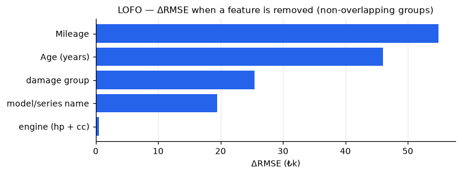

The chart shows 5 bars while the price model uses 25 features: 19 features were measured (2 as their own bar, 17 inside the 3 groups: `DAMAGE_COLS` · `MODEL_SERIES` · `ENGINE`); **6 features were never measured**: `brand` · `kb_body_type` · `kb_drivetrain` · `segment` · `kb_transmission` · `kb_fuel`.

## 7. Model comparison and limitations

The report's price model: **LightGBM (model/series name TF-IDF+SVD)** — MAPE **6.49%**, R² **0.9745**, MAE **₺110K**. Target `log1p(price)`, 25 features. 43% lower mean absolute error than the comparable-median baseline (same car model and year; a broader median when there is no comparable).

**What TF-IDF+SVD is applied to.** Not the free-text description — only the `model` and `series` name strings (e.g. "A4 Sedan 2.0 TDI"). The point is to let rare name combinations borrow information from their neighbours through name similarity, covering exactly where target encoding weakens in sparse cells. The seller's description never enters the model (see §1, third layer).

### Model variants

| variant | MAPE | R² | MAE | MedAE | RMSE |
|---|---:|---:|---:|---:|---:|
| LightGBM (model/series name TF-IDF+SVD) | 6.49% | 0.9745 | ₺109,776 | ₺75,320 | ₺176,225 |
| CatBoost (model/series name TF-IDF+SVD) ★ | 6.44% | 0.9745 | ₺110,085 | ₺74,927 | ₺176,130 |
| CatBoost (model/series name native text) | 6.58% | 0.9739 | ₺112,925 | ₺77,660 | ₺178,312 |
| comparable median (baseline, laddered) | 11.20% | 0.9235 | ₺191,224 | ₺130,000 | ₺305,050 |

★ = winner under the MAPE-only rule: **CatBoost (model/series name TF-IDF+SVD)**. But the two TF-IDF+SVD variants differ by 0.05 MAPE points and ₺309 MAE; LightGBM leads on MAE, CatBoost on MAPE, MedAE, RMSE → in practice they are **tied**. Throughout this report "the model" is LightGBM: deterministic on CPU, whereas CatBoost's trees depend on the device (GPU/CPU) — an earlier GPU run had the MAPE order reversed. The conformal interval and the brand ablation come from LightGBM.

### Baseline tier breakdown

| tier | listings | share | MAPE | MAE | R² |
|---|---:|---:|---:|---:|---:|
| car model + year | 29,236 | 97.49% | 10.69% | ₺179K | 0.9450 |
| car model | 596 | 1.99% | 26.70% | ₺559K | 0.6082 |
| global | 156 | 0.52% | 47.38% | ₺1.10M | -0.2359 |

Ladder: (model, year) median → (model) median — all years → global median. If the test (car model, year) cell is absent from the training fold, the baseline steps down a rung; error grows sharply at each step — without a comparable the baseline is weak anyway. Medians are computed on the training part of each fold only (leak-free, same 5 folds as the price model). "Model" in the tier names is the car model (the `model` column of the data), not the price model.

**Model limitations and observations.** Information that never reaches the form fields and hides in the free text — modifications, special equipment, tax-exemption status — does not enter the model; listings whose text mentions a conversion or modification have a raw large-error rate of 4.9% against 3.9% for the rest; with age, mileage, price, performance family, comparable count and brand held fixed the odds ratio is 1.14 (95% CI 0.94–1.37): no significant difference was measured. The wording appears in 43.6% of performance-family listings. Without comparables the error grows markedly: with no other listing of the same model and year the large-error rate is 19.0%, with 100+ comparables 2.9%; the largest lira errors sit at this end too (§8). No extensive hyperparameter optimisation was run, by choice; its payoff was not measured in this report. The model does not see time: it learns the prices of the four snapshots together, and the errors above come from a 5-fold OOF that mixes the snapshots; the error on the last snapshot's new listings is in §8.

The served LightGBM is trained on all listings with the median of the tree counts early stopping chose in CV (258 trees), i.e. at the setting measured above.

The serving bundle carries the interval too: the scale model (s), the multiplier k = 2.087, 29,988 sorted scores for the hit probability, and the comparables table (listing counts of the 2,194 (model, age) cells in training); the data's last snapshot is 2026-06-27. The interval and the hit probability are computed per request from these parts, with the recipe of §8. Three examples as the bundle serves them:

| example | estimate | comparables | interval | hit probability | on the site |
|---|---:|---:|---:|---:|---:|
| the dearest prediction among well-covered cells | ₺4.82M | 117 | −9.2% / +10.1% | 89.6% | 8 in 10 |
| the same car at an age its model never has in training | ₺2.29M | 0 | −25.5% / +34.3% | 42.9% | 4 in 10 |
| the same car, last letter of the model name dropped | ₺4.67M | 0 | −16.2% / +19.3% | 65.1% | 6 in 10 |

Comparables are found by matching the model name exactly against the training strings: a typo sets them to 0 and widens the interval (−16.2% / +19.3% instead of −9.2% / +10.1%). The error leans the cautious way, but the user should see why.

## 8. Calibration, residuals and where it is weak

OOF (leak-free) predictions vs actual — R² **0.9745**. Residual% is close to zero on average (mean -0.47%, std 9.27%). It holds at every level of the prediction too: the slope of actual on predicted price is **1.003**, and the mean bias across predicted-price quartiles ranges from −₺12K to −₺3K.

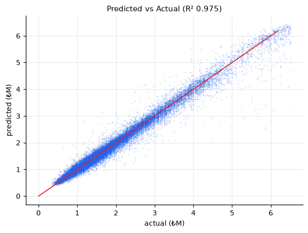

### Error distribution

| \|error\| band | listings | share |
|---|---:|---:|
| ≤ 5% | 15,775 | 52.6% |
| 5% – 10% | 8,221 | 27.4% |
| 10% – 20% | 4,784 | 16.0% |
| > 20% | 1,208 | 4.0% |

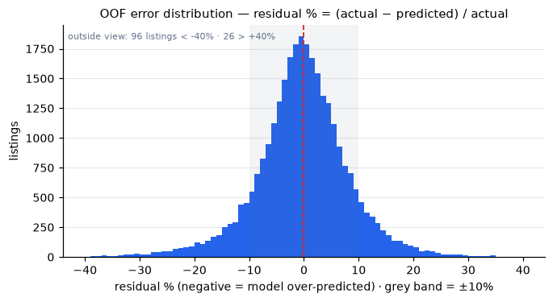

OOF error for all 29,988 listings. The distribution peaks at zero (median residual -0.27%); the share of listings within ±10% is **80.0%**. Mean |error| is 6.5% — the MAPE itself; median |error| 4.7%. On the percentage residual the tails look asymmetric: the model says more than 20% **above** the actual price for 768 listings and more than 20% **below** it for 440 (extremes -178.1% and +56.5%). All of that comes from the definition: the residual is divided by the actual price, so under-prediction is capped at 100% while over-prediction is unbounded. On a symmetric scale (one side more than 1.2× the other) 768 listings are over-predicted and 812 under-predicted — the asymmetry reverses. The std (9.27%) is inflated by that tail; median |error| describes the typical miss better.

### Where the large errors come from

There are 1,208 listings with an error beyond ±20% (768 over-, 440 under-predicted). The breakdowns below are counted from structured fields only — no text detector involved.

| listings of the same model+year | listings | large error | over-predicted | under-predicted |
|---|---:|---:|---:|---:|
| 1 | 610 | 19.0% | 10.7% | 8.4% |
| 2–4 | 1,584 | 10.5% | 6.2% | 4.3% |
| 5–19 | 5,732 | 4.7% | 3.0% | 1.7% |
| 20–99 | 16,505 | 3.0% | 1.9% | 1.1% |
| 100+ | 5,557 | 2.9% | 2.0% | 0.9% |

1. **No comparable.** With no other listing of the same model and year the large-error rate is 19.0%; with 100+ comparables 2.9%.
2. **Exotic or old car.** 19.1% in the F/S segments — but those two hold 444 listings in total (F 325 · S 119), so the riskiest bucket is also the thinnest. Others 3.8%; 12.0% at age ≥ 18 (younger 3.2%).

**Age 18 is not a threshold the data picked.** The large-error rate rises with age: age 5 0.35% · age 10 1.56% · age 15 7.86% · age 18 11.69% · age 21 15.34%. The largest one-year jump is between 16 and 17 (7.79% → 12.72%). Moving the cut between 8 and 21 keeps the old/young ratio between 3.5× and 6.7×; at 18 it is 3.7×. The oldest bucket also runs into the collection limit: data starts at model year 2005, so the 18-and-over bucket holds only 4 model years.

Association; not verified listing by listing. Information absent from the form (damage history, equipment, modifications) is a likely contributor, not measured here.

#### Examples

| car | year | km | price | model estimate | residual |
|---|---:|---:|---:|---:|---:|
| BMW 640i | 2011 | 160,000 | ₺5,600,000 | ₺3,236,953 | +42.2% |
| Audi 4.2 FSI Quattro R-tronic (R8) | 2008 | 112,550 | ₺4,690,000 | ₺2,744,815 | +41.5% |
| BMW 750i Long | 2007 | 271,000 | ₺1,190,000 | ₺2,831,842 | -138.0% |

- **BMW 640i · 2011:** Per the ad text the car is a full M6 conversion: M6 engine and M6 body parts. The form still says 640i, so the model prices an ordinary 640i while the buyer is looking at an M6.
- **Audi 4.2 FSI Quattro R-tronic (R8) · 2008:** The only R8 in the data. Its model name on the form is just "4.2 FSI Quattro R-tronic"; the S5 4.2 FSI Quattros sharing that engine name have a median of ₺2.62M (4 listings), and the model's estimate is close to that. With no comparable, the model priced a supercar like the similarly named S5.
- **BMW 750i Long · 2007:** There are 2 listings under this name; the other is a ₺5.30M converted 2009 car. This listing is in line with same-year 730ds (15 listings, median ₺1.18M) and its text says well-maintained with no pending costs. The listing is priced right and the model is wrong: lacking a comparable, it is probably pulled up by the name's other, expensive listing.

Predictions are OOF; the listing id (`ad_id`) is deliberately not published.

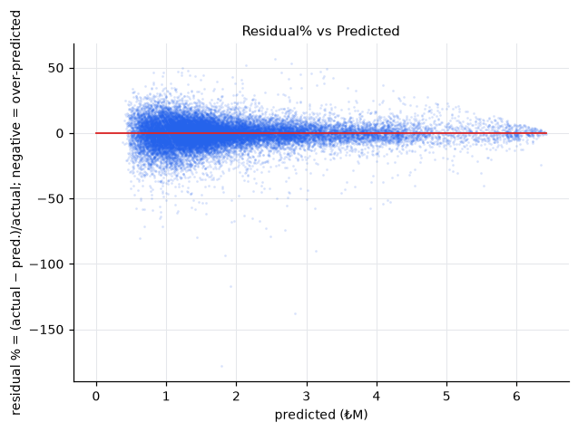

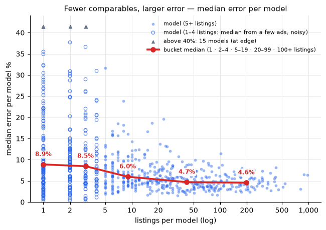

Each point is a model; the y axis is the median error across that model's listings. The bucket median is 8.9% for single-listing models and 4.6% for models with 100+ listings. The table above measures differently in two ways: it counts the **rate** of large errors and groups listings by model+**year**. Both point the same way — fewer comparables, larger error.

### Conformal interval and coverage

**A conformal interval** is a data-based price band the model offers alongside its single price. The served interval changes with the car: at the median prediction and median margin over all listings it is ₺1.36M – ₺1.73M.

- **No distributional assumption:** Errors are not assumed to follow a formula (a bell curve, etc.). The model's real errors on cars it has never seen are divided by the error size expected for that kind of car and sorted; the worst 10% are set aside and the multiplier (k = 2.087) is read directly from the data. The one assumption is that new listings resemble past ones; how well it holds on the last snapshot's new listings is below.
- **Per car and proportional:** A small second model (the scale model, s) estimates, from the car's form fields, its price estimate and its comparables count (listings of the same model and year in training), how large the log error usually is for this kind of car; the interval is log estimate ± k·s. The margin is applied as a percentage: −11.6% / +13.1% at the median car, −7.0% / +7.5% at the 5th percentile, −28.5% / +39.8% at the 99th. The width is 8.9% at the narrowest and 68.3% at the 99th percentile; for 62.4% of listings the interval is narrower than with one margin. s is constrained not to grow as comparables rise (mean s 0.093 at 0 comparables, 0.060 at 200) and is floored at 0.02; the floor does not bind out of fold; it binds on 2 of the 8,889 new listings.
- **About 90%, for the same period:** 90% holds approximately by construction: measured with each fold's interval built only from the other folds' errors, coverage is 90.09% (table below). That holds for listings of the same period, not over time: on the last snapshot's new listings it is 86.8% (below). The numbers describe asking prices of January–June 2026; on the 11,526 listings of the last snapshot (2026-06-27) coverage is 88.7% with one margin and 88.9% with the scale model.

**The weakness depends on age and comparables** (the breakdowns above), and it shows by price too: median error is 6.95% in the cheapest predicted quartile and 3.55% in the most expensive. With the same percentage for everyone the interval is too narrow in the cheap band, where the model errs more in proportional terms: Q1 coverage is 81.0%.

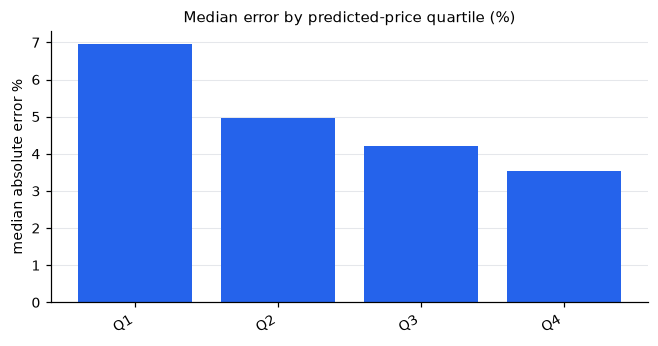

In lira the picture changes: 38.9% of total lira error sits in the most expensive predicted quartile and 17.6% in the cheapest; mean absolute error ₺171K against ₺77K.

**Three methods, in the same cross-calibrated measurement** (each fold's interval from the other folds' errors only):

| method | coverage | width median / mean | interval score | no comparable (752 listings) |
|---|---:|---:|---:|---:|
| one margin (same for all) | 89.99% | 28.3% / 28.3% | 0.4211 | 70.7% |
| per-band margin | 90.01% | 25.9% / 27.5% | 0.4059 | 66.8% |
| scale model (served) | 90.09% | 24.7% / 27.2% | 0.3657 | 90.3% |

Width is a percentage of the estimate. The interval score is the width plus a penalty for prices that fall outside, in log space (Winkler); smaller is better. No comparable: no listing of the same model and year in the other folds.

**What the scale model changes.** One margin gives everyone the same width: wider than needed on young and dear cars, too narrow on old, comparable-less and damaged ones. The scale model spreads the margin by car (table below): coverage goes 75.2% → 88.5% at age 19+, 70.7% → 90.3% without a comparable, 80.5% → 89.7% with a heavy-damage record; 97.4% → 90.8% at age 0–3 and 94.7% → 90.7% in the dearest predicted quarter, because the interval narrows there. In groups by what s takes as input (age, mileage, engine power, segment, fuel, transmission, body type, damage, series frequency; 42 groups of at least 200 listings) 18 groups are 5 or more points off target with one margin (largest gap 25.2 points) and 0 with the scale model (largest 3.5); partly by design, since s takes these as input. On what s does not see (seller type, city, colour, warranty, first owner, trade-in, damage record amount; 32 groups) no fix is expected: 4 groups sit 3 or more points below the arm's own overall coverage with one margin, 4 with the scale model; its worst is a group on first owner (302 listings, −5.7 points).

**The trade.** The per-band margin carried a coverage guarantee in each price band; the scale model gives that up, and its coverage in the bands (89.6%–90.7%) is a measured result, not a guarantee. In return it gives a width per car, a narrower median interval and the best interval score out of fold. The method, the settings of s, the comparables constraint and the ±10% tolerance were set after these results were seen; none was searched, and no independent test checks the choice afterwards. Coverage and hit refer to the asking price, not the sale price.

**By kind of car (OOF).** The interval is around the group's median estimate (₺M); hit is the probability that the asking price is within ±10% of the estimate, predicted → observed.

| kind of car | listings | coverage: one margin → scale | margin: scale | interval: one margin | interval: scale | hit |
|---|---:|---:|---:|---:|---:|---:|
| all | 29,988 | 90.0% → 90.1% | −11.6% / +13.1% | 1.33–1.77 | 1.36–1.73 | 78.3% → 78.3% |
| age 0–3 | 2,649 | 97.4% → 90.8% | −7.5% / +8.1% | 3.42–4.53 | 3.64–4.25 | 92.1% → 92.3% |
| age 4–7 | 4,420 | 97.5% → 90.5% | −7.4% / +8.0% | 2.36–3.13 | 2.52–2.93 | 91.7% → 92.1% |
| age 8–12 | 12,264 | 92.7% → 89.9% | −10.5% / +11.7% | 1.38–1.83 | 1.42–1.78 | 81.7% → 81.6% |
| age 13–18 | 8,853 | 83.3% → 90.3% | −15.2% / +17.9% | 0.96–1.27 | 0.94–1.30 | 67.0% → 66.5% |
| age 19+ | 1,802 | 75.2% → 88.5% | −18.1% / +22.1% | 0.60–0.80 | 0.57–0.85 | 58.5% → 58.9% |
| no comparable | 752 | 70.7% → 90.3% | −19.7% / +24.6% | 1.49–1.98 | 1.38–2.14 | 53.1% → 55.6% |
| 20+ comparables | 20,081 | 91.9% → 90.3% | −10.8% / +12.1% | 1.30–1.73 | 1.34–1.68 | 81.2% → 80.9% |
| cheapest predicted quarter | 7,497 | 81.0% → 89.9% | −16.3% / +19.4% | 0.79–1.04 | 0.76–1.08 | 64.7% → 64.0% |
| dearest predicted quarter | 7,497 | 94.7% → 90.7% | −8.0% / +8.7% | 2.71–3.59 | 2.87–3.39 | 87.4% → 87.5% |
| highest-mileage fifth | 5,998 | 79.9% → 89.9% | −16.5% / +19.8% | 0.91–1.20 | 0.87–1.25 | 63.5% → 63.0% |
| heavy-damage record | 1,407 | 80.5% → 89.7% | −15.8% / +18.7% | 1.04–1.38 | 1.01–1.42 | 64.0% → 63.2% |
| segment F | 325 | 65.8% → 86.5% | −21.8% / +27.9% | 2.30–3.05 | 2.07–3.39 | 49.6% → 51.7% |

**Margin per band (Mondrian).** The pre-registered middle road: with the margin computed separately in each predicted-price quartile, coverage is 89.96%–90.04% in every band. The price is width: in the cheapest band the interval widens from 28.3% to 37.1% of the estimate, in the most expensive it narrows to 21.4%. The scale model sets the width by car within a band too: the median width is 35.7% in the cheapest band and 16.7% in the most expensive.

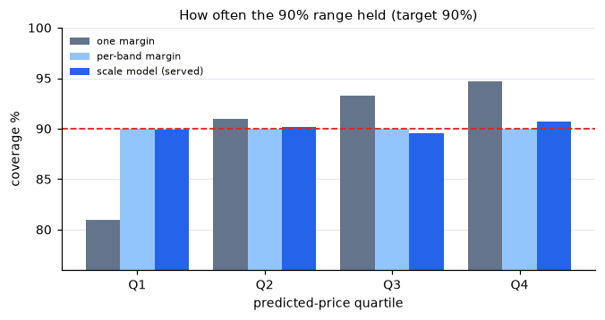

| band | predicted price | coverage: one margin | coverage: per band | coverage: scale | width: per band | width: scale |
|---|---|---:|---:|---:|---:|---:|
| Q1 | below ₺1.15M | 81.0% | 90.0% | 89.9% | 37.1% | 35.7% |
| Q2 | ₺1.15M – ₺1.53M | 91.0% | 90.0% | 90.2% | 27.2% | 25.8% |
| Q3 | ₺1.53M – ₺2.26M | 93.2% | 90.0% | 89.6% | 24.4% | 20.9% |
| Q4 | above ₺2.26M | 94.7% | 90.0% | 90.7% | 21.4% | 16.7% |

**Note:** The bands are cut on the predicted price, the only thing a pricing tool knows; grouping by the actual price produces regression to the mean. Width is the band's median distance between the interval's lower and upper end (a percentage of the estimate).

**Hit probability.** It comes from the same computation as the interval, no new model needed: the probability that the asking price of this kind of car is within ±10% of the estimate, i.e. the share of scores at or below log(1.1) / s. It is calibrated out of fold: mean predicted 78.3%, observed 78.3%; the Brier score is 12.2% better than giving everyone the same probability. It separates cars: the probability's 10th percentile is 57.9%, its 90th 95.4%. The site shows it as "N in 10", rounded down and at most 9, so "10 in 10" is never shown; of the cars shown 9, 94.2% hit.

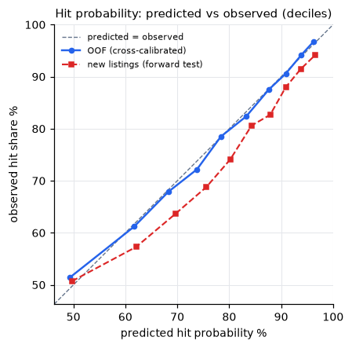

**On new listings: the forward test.** A model trained on the 21,099 listings seen before the last snapshot (each at its latest price) priced the 8,889 listings first seen in the last snapshot (2026-06-27). MAPE 6.78% (95% interval 6.42%–7.17%); the 5-fold OOF, which mixes the snapshots, gives 6.49%. The served interval recipe was applied as is: q, the band edges, s and k come only from the training listings (k = 2.100). Coverage is 87.4% with one margin, 88.0% with the per-band margin and **86.8%** with the scale model: that is the number for new listings, not 90%. On the 297 listings whose model and year never occur in training, one margin and the per-band margin stay below target while the scale model is close to it (table). Most misses fall above the interval: with the scale model 10.5% of listings land above it and 2.7% below. The signed error (log price − log estimate, ×100) is +2.02 at the median and +2.46 on average: new listings tend to sit above the estimate. This number is not a measure of price increase; its parts are not separated in this report.

| method | coverage | width median / mean | interval score | no comparable (297 listings) | missed above | missed below |
|---|---:|---:|---:|---:|---:|---:|
| one margin (same for all) | 87.4% | 28.2% / 28.2% | 0.4438 | 68.3% | 8.9% | 3.7% |
| per-band margin | 88.0% | 27.1% / 27.4% | 0.4296 | 65.3% | 8.9% | 3.1% |
| scale model (served) | 86.8% | 24.0% / 26.8% | 0.3977 | 88.5% | 10.5% | 2.7% |

In fifths by the width of the scale interval the scale model covers 85.3%–89.6%; one margin covers 98.0% of the same cars in the narrowest fifth and 70.6% in the widest.

**Level only (a what-if, not a time analysis).** If every asking price in today's data were 2% / 5% / 10% higher, coverage would be 89.2% / 86.1% / 73.9% with one margin and 88.6% / 82.3% / 61.6% with the scale model; 87.0% / 73.6% / 33.7% in the narrowest fifth of the scale interval (today 90.5%), and the observed hit share 77.1% / 70.6% / 49.4% (today 78.3%). A narrow interval loses its coverage first when the level shifts.

On new listings the hit probability is optimistic (figure above): mean predicted 79.1%, observed 75.1%; the Brier score is still 9.7% better than a constant; of the cars shown 9, 91.5% hit. Correcting it by looking at the test set would be tuning, so it was not done.

### The largest errors

**Listings with an inconsistent engine value.** 15 listings (0.05%) have a power or displacement more than 1.5× off their own model's median: the catalogue match collapsed and the model is pricing an engine the car does not have; their median error is 12.8% against 4.7% for the rest. The check only works on models with at least 5 listings: the 632 listings (2.11%) of the 307 smaller models are its blind spot — exactly where comparables are scarcest.

**The largest errors in lira.** Of the top 100 lira errors 73 are under- and 27 over-predictions. That direction is not a lean of the model: if the actual price scattered symmetrically around the prediction on the log scale, 67.8 of the top 100 (95%: 60–77) would still be under-predictions; the same percentage error is bigger in lira when the price is above the prediction. 84 sit in the most expensive predicted quartile. The series that take their segment from the model name (M Serisi, RS, S, i Serisi) are 0.52% of the data but 23 of the top 100 — 44× their share of the data. The price cap (₺6.50M) also truncates the range the model learns at this end; under-prediction on the most expensive listings should be read with that limit in mind.

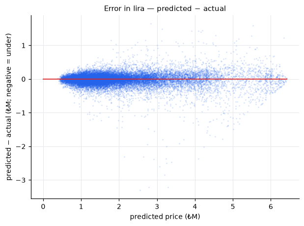

## 9. Free text: measured, left out

The seller's description does **not** enter the model. That is a measurement, not an oversight: the model of §7 scores R² **0.9699** on log price, and with the description added on the same folds **0.9707** — ΔR² **0.0008**, 2.6% of the log variance the model leaves unexplained. MAPE 6.49% → 6.41%, mean absolute error ₺109,776 → ₺108,770.

The text arm uses the model's features, folds and LightGBM settings; the description is added as word TF-IDF (1–2 grams) and 50 SVD components, both fitted on each fold's training part only. The gap is below the pre-registered threshold (ΔR² < 0.005 and a MAPE gain < 0.2 points), so the text was not added to the model. The measurement is repeated on every run; if the threshold is crossed this section is not produced.

Listings whose text mentions a conversion, an engine swap or modifications are flagged separately: 3,107 listings (10.4%), the text flag in §7. The flag is a plain word rule; its word list was distilled from the vocabulary of an archived LLM extraction trial and is applied to today's text on every run.
