# İkinci El Araç Piyasası Analizi — Teknik Rapor

Bu rapor iki soruya yanıt arar: İkinci el araç fiyatını ne belirler ve model bunu ne kadar isabetle öngörebilir? Analiz; **29.988** TR plakalı BMW/Audi ilanında veri temizliği ve sızıntı kontrolünden geçerek kontrollü fiyat etkileri, piyasa yapısı, model karşılaştırması ve yeni ilanlarda bir ileri testi ortaya koyar. LightGBM ortalama **%6.49** yüzde hatayla (MAE: **₺110K**, R²: **0.9745**) çalışarak emsal medyanına (aynı araç modeli ve yıl; emsal yoksa daha geniş medyan) göre ortalama mutlak hatada (MAE) **%43** daha iyi sonuç verir. Manşet metrikler, modelin daha önce görmediği veriler üzerinden **5-fold out-of-fold** kurgusuyla hesaplanmıştır; ileri test §8'de. Hedef ilan fiyatıdır, satış fiyatı değil: satış fiyatı pazarlıkla bundan ayrılır.

## 1. Veri temizleme ve sızıntı tespiti

**TR plakalı 45.159 tarama kaydı → 29.988 ilan.** Aradaki 15.171 satır aynı ilanın sonraki taramalarda yeniden görülmesi; `ad_id` başına en son kayıt alındı. Tekrarlar bilgi taşıyor ama model bunu kullanmıyor: birden çok taramada görülen 10.831 ilandan 4.703 tanesinin fiyatı değişmiş (2.801 indirim, 1.854 zam; 48 ilan eski fiyatına döndü).

Medyan ilan fiyatı ₺1.55M, ₺0.85M–₺3.43M arası (P10–P90).

**Kapsam: yalnız TR plakalı araçlar.** 22 mavi plakalı ilan (Türkiye'de oturan yabancıların aracı) modele ve analize alınmadı: vergilendirme rejimleri farklı, modeli ve analizi yanıltır. Plaka bilgisi boş olan 54 ilan da, hangi rejime girdiği bilinmediği için alınmadı.

**Kapsam: toplama filtreleri.** Veri Audi ve BMW ilanlarından, sitenin otomobil kategorisinden şu filtrelerle toplandı: fiyat ₺300K–₺6.50M, en fazla 700.000 km, 2005 ve sonrası model yılı, yakıt Benzin, Dizel, Hibrit, LPG. Üç sonucu var:

- **Fiyat sağdan kesik.** En pahalı ilan tam tavanda (₺6.50M); tavanda 10 ilan var, üstünde hiç yok. Tavanın üstündeki araçlar veride değil; en pahalı uçtaki tahminler bu sınırla birlikte okunmalı.
- **Yaş en fazla 21.** 2005 model yılında 541 ilan var; daha eski araçlar toplanmadı, yani en yaşlı kova toplama sınırına dayanıyor.
- **Gövde ve yakıt.** Yalnız otomobil kategorisi toplandı, öteki kategoriler toplanmadı: veride 6 SUV var. Yakıt filtresi elektrikliyi dışarıda bırakıyor: 0 elektrikli ilan.

### Ön işleme ve filtreler

Toplanan veriye modelden önce sırasıyla şunlar uygulandı:

1. **Plaka:** yalnız TR plakalı satırlar alındı: 45.315 tarama satırından 45.159 satır. 22 mavi plakalı ve plaka bilgisi boş 54 ilan tümden dışarıda kaldı (gerekçesi yukarıda).
2. **Tekilleştirme:** `ad_id` başına en son tarama: 45.159 satır → 29.988 ilan.
3. **"Belirtilmemiş" = yok:** belirtilmemiş panel orijinal, belirtilmemiş ağır hasar kaydı ağır hasarsız sayıldı (aşağıda).
4. **Motor aralığı → tek sayı:** hacim aralığın üst sınırı, güç alt ve üst sınırın ortalaması (aşağıda).
5. **Hasar:** 39 ham panel bayrağı 12 özniteliğe indirildi (aşağıda).
6. **Eksik değer:** sayısal özniteliklerde doldurma yok, boş değer modele boş gidiyor; kategorik boşluk ayrı bir `missing` kategorisi (aşağıda).
7. **Aykırı değer atılmadı:** fiyat, km ve yaş kırpılmadı; TR plakalı her ilan modelde.
8. **Hedef:** `log1p(price)`.

### Ölçek

| kalem | değer |
|---|---:|
| TR plakalı tarama kaydı (tüm taramalar) | 45.159 |
| tekil ilan (`ad_id` dedup) | 29.988 |
| tarama dönemi | 4 (2026-01-18 – 2026-06-27) |
| ham kolon (besleme) | 117 |
| modele giren öznitelik | 25 |
| BMW / Audi | 17.896 / 12.092 |
| hedef | `log1p(price)` |

### Üç veri katmanı

1. **Yapısal** — yaş · km · motor gücü/hacmi · kasa · yakıt · vites · çekiş · segment.
2. **Hasar / ekspertiz** — 13 kaporta paneli × {değişen, boyalı, lokal boya} + ağır hasar kaydı. Bu 39 ham bayrak modele 12 öznitelik olarak giriyor: tavan · kaput · bagaj tek panel olduğu için **durum** (orijinal/lokal/boyalı/değişen), kapı · çamurluk · tampon ise grup içi **sayı** (kapı 0–4, çamurluk 0–4, tampon 0–2).
3. **Serbest metin** — satıcı açıklaması; modelde **kullanılmıyor**. Ölçüldü: log R²'ye katkısı 0.0008; ayrıntısı §9'da.

**"Belirtilmemiş" panel orijinal sayıldı.** Site her panel için beş cevaptan birini veriyor: orijinal, belirtilmemiş, boyalı, lokal boyalı, değişmiş. Modele giren ilanlarda 59.651 panel (%15.3) belirtilmemiş; 1.235 ilanda 13 panelin hiçbiri belirtilmemiş. Bu cevap bilinçli bir kararla orijinal gibi kodlandı; gerekçe, satıcının hasarı yazmayı unutmuş olabileceği ama hasar olmamasının daha olası sayılması.

**Ağır hasar kaydında da aynı kural.** Modele giren ilanlarda sayfanın ağır hasar bilgisi vermediği ("Belirtilmemiş" ya da alan yok) ilanların payı %68.2; bunlar ağır hasarsız sayıldı. Ağır hasarlı olup bunu belirtmeyen bir ilan modelde ağır hasarsız görünür.

### Motor gücü ve hacmi: aralıktan tek sayıya

Site motor hacmini ve gücünü ilanların bir kısmında kesin değer, bir kısmında **aralık** olarak veriyor: modele giren ilanlardan 7.865 tanesinde hacim, 7.797 tanesinde güç aralıklı (en sık aralıklar 1401–1600 cc ve 151–175 hp). Model tek sayı kullanıyor. Kural: **hacim = aralığın üst sınırı, güç = alt ve üst sınırın ortalaması** (açık uçlu aralıkta bilinen sınır). Kural veriyle sınandı: aralıklı ilanın üç adayı, aynı modelin kesin değerli ilanlarının medyanıyla karşılaştırıldı — hacimde 7.176, güçte 7.148 ilan (kesin değerli ilanı olan modellerde).

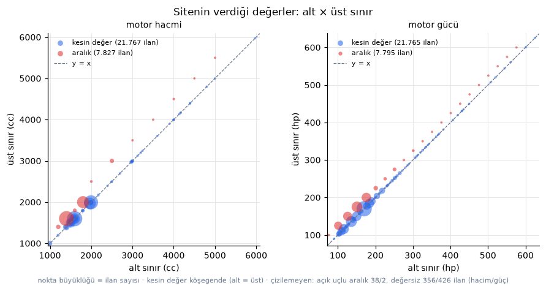

Örnek: 1401–1600 cc aralığı verilen bir ilanın aynı modeli, hacmi tek sayı verilen ilanlarında en çok 1598 cc yazıyor; bu ilan için adaylar alt sınır 1401 (197 cc uzak), orta nokta 1500.5 (97.5 cc), üst sınır 1600 (2 cc). Aşağıdaki tablodaki sayı, bu uzaklıkların bütün aralıklı ilanlar üzerindeki medyanı; her modelin referansı, kendi tek sayılı ilanlarının medyanı.

| aday | hacim: medyan mutlak fark | güç: medyan mutlak fark |
|---|---:|---:|
| alt sınır | 194 cc | 17 hp |
| orta nokta | 95.5 cc | **7 hp** |
| üst sınır | **5 cc** | 14 hp |

Hacimde kesin değer aralığın üst sınırına çok yakın (aralık içindeki medyan konumu %97.5, alt çeyrek %83.9; en sık aralığı paylaşan modellerin en sık kesin değeri 1598 cc), bu yüzden üst sınır neredeyse tam isabet ediyor; en az 100 ilanlı aralıkların hepsinde (5/5) en yakın aday üst sınır. Güçte en yakın aday güç düzeyine göre değişiyor (en az 100 ilanlı aralıklar): 101–125 hp orta nokta; 126–175 hp üst sınır; 176–225 hp alt sınır; 226–250 hp alt sınır ile orta nokta berabere; 251–275 hp alt sınır. Kesin değerin aralık içindeki konumu da bu yüzden dağınık (çeyrekler %29.2–%79.2). Tek bir kural olarak orta nokta, bütün aralıklı ilanlarda medyan farkı en küçük aday. Aynı modelin kesin değer medyanı aralığın içine düşüyor: hacimde %97.9, güçte %84.2 ilanda; güçte dışarıda kalanlarda birden çok kesin güç değeri olan modellerin payı %90.3 — aynı model adı farklı motor seçenekleri taşıyor, yani bu oran sitenin aralığının değil referansın kabalığını gösteriyor. Kural veriyle çelişirse (seçilen aday en küçük medyan farkı vermezse) üreteç durur.

Sebep motorların litre etiketi: "1.6" diye satılan bir motorun gerçek hacmi 1598 cc gibi, etiketin birkaç cc altında. Sitenin aralıkları da bu etiket değerlerinde bitiyor (1401–1600 cc), bu yüzden gerçek hacim neredeyse her zaman aralığın üst sınırına çok yakın. Güçte böyle bir etiket yok; gerçek değerler aralığın içine dağılıyor, orada ortalama daha iyi tutuyor.

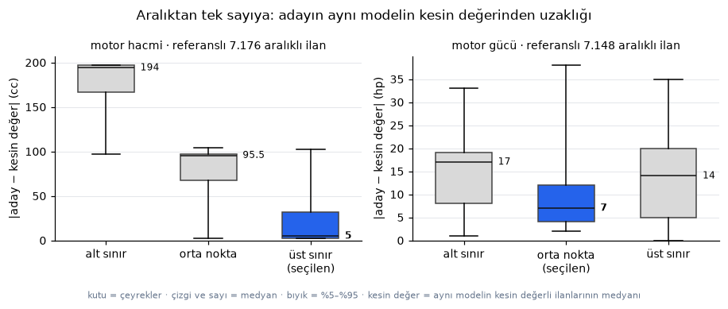

### Tutulan öznitelikler (25)

Model (`model`) · Seri (`series`) · Marka (`brand`) · Kasa Tipi (`kb_body_type`) · Çekiş (`kb_drivetrain`) · Segment (`segment`) — seri ve model adından türetildi · Vites Tipi (`kb_transmission`) · Yakıt Tipi (`kb_fuel`) · Tavan Durumu (`roof_state`) · Kaput Durumu (`hood_state`) · Bagaj Durumu (`trunk_state`) · Yaş (yıl) (`vehicle_age`) · Kilometre (`gb_mileage`) · Motor Gücü (hp) (`power_hp_val`) · Motor Hacmi (cc) (`engine_cc_val`) · Kapı Değişen (`door_changed`) · Kapı Boyalı (`door_painted`) · Kapı Lokal Boya (`door_local`) · Çamurluk Değişen (`fender_changed`) · Çamurluk Boyalı (`fender_painted`) · Çamurluk Lokal Boya (`fender_local`) · Tampon Değişen (`bumper_changed`) · Tampon Boyalı (`bumper_painted`) · Tampon Lokal Boya (`bumper_local`) · Ağır Hasarlı (`is_heavy_damaged`)

### Atılan öznitelik grupları

117 ham kolonun 53 tanesi modele doğrudan ya da türetilerek giriyor (bunların 39 tanesi hasar bayrağı), biri hedef (fiyat), 63 tanesi atıldı. Her ham kolon aşağıdaki sınıflardan tam birine atanıyor; tablo koddan hesaplanıyor.

| grup | gerekçe | kolon | kolonlar |
|---|---|---:|---|
| C | Kimlik / metin / zaman | 8 | `ad_id`, `listing_date`, `ad_title`, `location`, `eids_model`, `url` … |
| F | Türetilmiş tekrar | 9 | `engine_cc_low`, `engine_cc_val`, `engine_cc_is_range`, `power_hp_val`, `power_hp_is_range`, `count_changed` … |
| B | kb/gb ikizi | 11 | `kb_year`, `kb_mileage`, `gb_transmission`, `gb_fuel`, `gb_body_type`, `gb_color` … |
| A | Yarı-sabit (en sık değer ≥ %99) | 4 | `kb_condition`, `gb_usage_type`, `gb_is_first_owner`, `gb_plate_origin` |
| D | Eksik > %40 | 5 | `gb_mtv_yearly`, `tramer_fee`, `transmission_brand`, `gb_kasko_avg`, `gb_traffic_insurance_avg` |
| E | Katalog bloğu (birlikte eksik) | 22 | `kb_fuel_cons_avg`, `kb_fuel_tank`, `gb_segment`, `torque_nm`, `cylinder_count`, `max_speed_kmh` … |
| G | Modele alınmadı, gerekçe kayıtlı değil | 4 | `kb_color`, `kb_trade_available`, `kb_seller_type`, `gb_warranty_status` |

*`engine_cc_val`, `power_hp_val`: veritabanındaki kolonlar (aralığın orta noktası). Model ikisini de alt ve üst sınırlardan yeniden türetiyor (yukarıdaki motor kuralı): güçte alt–üst ortalaması, yani veritabanı kolonuyla aynı değer; hacimde üst sınır, yani aralıklı ilanlarda veritabanındakinden farklı.*

Sayısal özniteliklerde doldurma yapılmadı: eksik değerler LightGBM ve CatBoost'a boş (NaN) olarak girer ve kütüphanenin kendi eksik-değer yönlendirmesi kullanılır; kategorik boşluklar ayrı bir `missing` kategorisi olur. Yalnız KMeans/PCA için genel medyanla dolduruldu; %27.6 eksik olan `torque_nm` ise analiz dışı bırakıldı.

**Sızıntı kontrolü.** Dedup (ilanların tekilleştirilmesi) `ad_id` üzerinden ve CV'den ÖNCE yapıldı. Değerlendirme 5-fold out-of-fold: her ilan tam olarak bir kez, kendisini görmemiş bir modelle tahmin edildi.

### İçerik bazlı tekrar

| tanım | fazla satır | pay |
|---|---:|---:|
| katı — tüm ayırt edici alanlar aynı | 137 | %0.46 |
| gevşek | 209 | %0.70 |
| fiyat hariç katı | 1.278 | %4.26 |

`ad_id`'nin göremediği risk: `ad_id` farklı ama ilan aynı. Katı tanım 127 tekrar grubu buluyor; kolonları: `price`, `gb_mileage`, `gb_year`, `brand`, `series`, `model`, `kb_fuel`, `is_heavy_damaged`, `count_painted`, `count_changed`, `power_hp_up`, `engine_cc_up`. Bir kısmı gerçek tekrar ilan, bir kısmı yaygın modellerde tesadüfi çakışma. İlk iki tanım fiyat eşitliği istiyor, yani fiyatı değiştirilip yeniden yayımlanan ilanı göremez. Fiyatı dışarıda bırakan katı tanım 1.278 fazla satır (%4.26) buluyor; bunun ne kadarı fiyatı değiştirilmiş yeniden ilan, ne kadarı yaygın bir modelde tesadüfi çakışma, veriden ayrılamıyor. Fold'lar arasına sızabilecek pay bu iki tanıma göre %0.46 (katı) ile %4.26 (fiyat hariç) arasında; kilometresi de değiştirilmiş bir yeniden ilanı ikisi de göremez.

En çok tekrar eden ilanlar:

| model | yıl | fiyat | tekrar |
|---|---:|---:|---:|
| 320i Sport Line | 2025 | ₺4.900.000 | 4 |
| 318i Standart | 2005 | ₺717.000 | 3 |
| A3 Sportback 1.6 Ambition | 2010 | ₺890.000 | 3 |
| 116d Joy Plus | 2015 | ₺1.044.950 | 3 |
| 320i First Edition Sport Line | 2019 | ₺2.530.000 | 3 |

## 2. Eksiklik rastgele değil

32 kolon %2'nin üzerinde eksik. 22 tanesi birlikte düşen dört blokta: bunlar "eksik veri" değil, katalog eşleşmesinin çöktüğü ilanlar — standart modeller eşleşir, niş varyantlar eşleşmez, tüm özellik listesi birden boşalır. Sistematik olduğu için güvenilir imputasyon yok → bu kolonlar çıkarıldı. Kalan 10 kolonun eksikliği başka kaynaktan; her biri kendi sınıfında atıldı (§1 tablosu) — eksik > %40: `tramer_fee`, `transmission_brand`, `gb_traffic_insurance_avg`, `gb_kasko_avg`, `gb_mtv_yearly` · kb/gb ikizi: `gb_drivetrain`, `gb_trade_available` · modele alınmadı, gerekçe kayıtlı değil: `gb_warranty_status`, `kb_trade_available` · kimlik / metin / zaman: `eids_model`.

Geriye kalan 25 öznitelikte eksiklik sorun değil: en yükseği `kb_drivetrain` ile %1.5, 21'inde hiç eksik yok. Yukarıdaki grafik yalnız atılan kolonları gösteriyor.

**"Belirtilmemiş", eksik veri değil.** Sayfanın söylemediği bilgi veride boş duruyor. 45 kolonda bu boşluk eksik veri değil, satıcının "belirtilmemiş" cevabı; bu kolonlar yukarıdaki listeye ve bloklara girmiyor. Belirtilmemiş payı ağır hasar kaydında %68.2, 39 panel bayrağının her birinde %12.2–%19.1. Model bu bilinmeyenleri bilinçli bir kararla "yok" okuyor: belirtilmemiş panel orijinal, belirtilmemiş ağır hasar kaydı ağır hasarsız sayılıyor (§1).

### Birlikte eksik bloklar

| kolon | ort. eksik | birlikte eksik | örnek kolonlar |
|---:|---:|---:|---|
| 16 | %27.6 | %98.8 | `weight_kg`, `kb_fuel_cons_avg`, `kb_fuel_tank`, `gb_segment` … |
| 2 | %31.4 | %100.0 | `city_fuel_cons`, `highway_fuel_cons` |
| 2 | %29.9 | %100.0 | `production_year_start`, `production_year_end` |
| 2 | %29.3 | %100.0 | `rpm_max`, `rpm_min` |

*Birlikte eksik: blok kolonlarının hepsinin eksik olduğu ilanların, en az birinin eksik olduğu ilanlara oranı.*

### gb_ / kb_ çift kaynak

| alan | Genel Bakış (gb) boş | KısaBilgi (kb) ikizi |
|---|---:|---|
| Çekiş (`gb_drivetrain`) | %74.0 | `kb_drivetrain` · eksik %1.5 |
| Ort. Trafik Sigortası (`gb_traffic_insurance_avg`) | %54.3 | yok |
| Ortalama Kasko (`gb_kasko_avg`) | %51.1 | yok |
| Yıllık MTV (`gb_mtv_yearly`) | %40.6 | yok |

**kb/gb.** İlan sayfasında aynı bilgi iki sekmede yer alabiliyor: `kb` kısa bilgi, `gb` genel bakış. 10 çiftin 8 tanesinde iki sekme birebir aynı. 6 çiftte bir taraf modelde, öteki atıldı; 4 çiftte (`color`, `condition`, `trade_available`, `seller_type`) hiçbir taraf modelde değil. §1 tablosundaki ikiz sınıfında bir kolon daha var: `kb_is_heavy_damaged`, `is_heavy_damaged` ile birebir aynı. Çekişte `gb` ilanların %74.0 kadarında boş, `kb` %1.5. **Kasa tipinde `kb`, daha genel olduğu için seçildi:** 9 kategori; `gb` aynı bilgiyi koltuk sayısıyla birleştirip 23 değere bölüyor. Karşılığı olmayan ve %40'tan fazlası boş 3 alan (Ort. Trafik Sigortası, Ortalama Kasko, Yıllık MTV) ise elendi.

## 3. Fazlalık, bağıntı ve marka

Theil's U(a | b), b bilinince a'nın belirsizliğinin ne kadarının gittiğini verir (0–1) ve yönlüdür. Asimetri bulgunun kendisi: `model` `brand`, `segment`, `series` değerini neredeyse tam belirliyor (U ≥ 0.99) ama tersi değil — yani `seri`, `model`in kabalaştırılmış hâli, bağımsız bilgi değil.

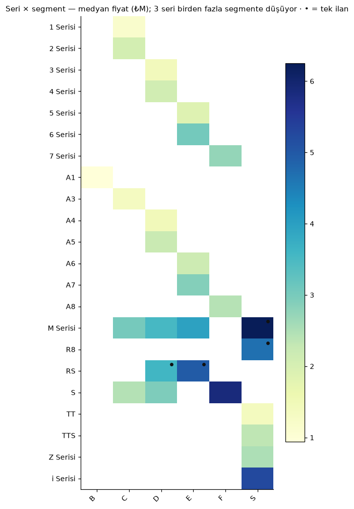

Ters yönde seri modeli yalnız 0.39 belirliyor. Marka hem modelden hem seriden tamamen okunuyor (U(marka | model) = 1.00): marka ayrı bilgi taşımaz; aşağıdaki marka ablasyonu aynı sonucu ölçer.

Sayısal öznitelikler arasında Spearman korelasyonu (sıra ilişkisi; aşağıdaki harita). |ρ| > 0.5 olan çiftler: Yaş (yıl)–Kilometre 0.74, Motor Gücü (hp)–Motor Hacmi (cc) 0.61, Kapı Boyalı–Çamurluk Boyalı 0.60. Hedonik regresyondaki çoklu bağlantı §6'da VIF ile ölçülüyor; orada kapı ve çamurluk boyaları ayrı değil, toplam boyalı parça sayısı olarak giriyor.

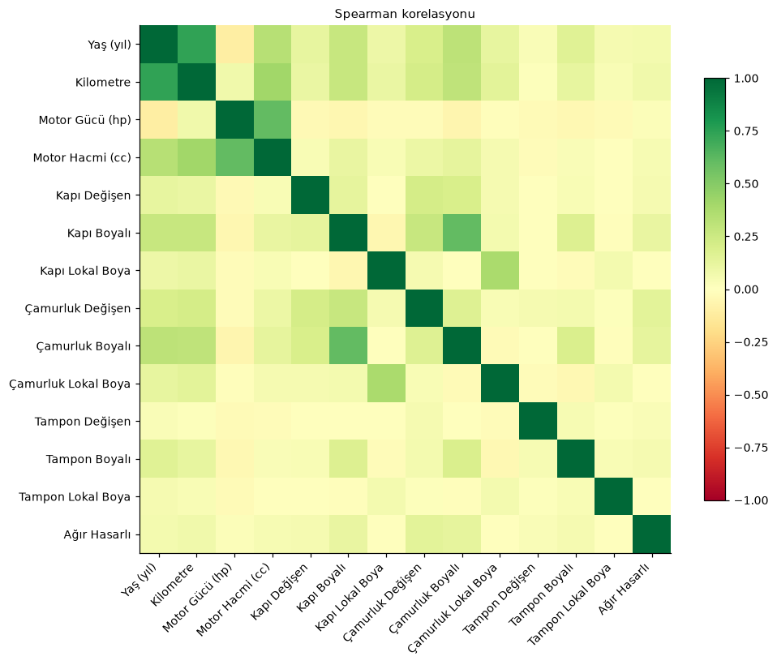

### Segment beslemeden gelmiyor, türetiliyor

Ham `gb_segment` kullanılmıyor ve gerekçesi yalnız eksiklik değil: beslemenin "G" segmenti gerçek bir segment değil. O etiketi taşıyan 215 ilandan 214 tanesinin gövdesi MPV ve hepsi tek seriden geliyor — bozuk kaynak. Segment bu yüzden türetiliyor; MPV bilgisi kasa tipinde duruyor.

İlanların 29.832 tanesi segmentini doğrudan serisinden alıyor. Bazı ailelerde (`M Serisi`, `RS`, `S`, `i Serisi`) segment seriden değil model adından çözülüyor — örneğin M3 → 3 Serisi, S3 → A3 — toplam 156 ilan. Bu yüzden segment yalnız serinin değil (seri, model) çiftinin fonksiyonu: U(segment | seri) = 0.997, tam 1 değil. Çözülemeyen seri ya da model kalırsa üreteç durur; sessiz bir varsayılan segment yok.

Türetilen etiket, ham segmenti dolu 21.723 ilanın 404 tanesinde (%1.9) beslemeden ayrılıyor; 215 tanesi bilinçli G düzeltmesi, en büyük ikinci kaynak beslemenin E dediği 95 ilanın burada D olması.

### Marka ablasyonu

| kimlik kolonları | MAPE | MAE | R² |
|---|---:|---:|---:|
| yalnız marka | %8.80 | ₺163K | 0.9413 |
| seri + model | %6.49 | ₺110K | 0.9745 |
| marka + seri + model (rapordaki model) | %6.49 | ₺110K | 0.9745 |

Tam modelde yalnız kimlik kolonları değişiyor, diğer öznitelikler sabit; aynı 5-fold OOF. "Yalnız marka" kolu segmenti de dışarıda bırakıyor, çünkü segment seriden türetiliyor. Seri+model yerine yalnız marka verilince MAE ₺53K kötüleşiyor. Seri+modelin üzerine marka eklemek MAE'yi ₺1 değiştiriyor (MAPE farkı 0.00 puan) — manşet modelin 5 fold'unda marka 26 bölmede kullanılıyor ama hatayı değiştirmiyor. Bu bir ölçümden çok verinin tanımı: bu korpusta her seri tek bir markaya ait (U(marka | seri) = 1.00), marka seriden okunabiliyor.

## 4. Hedef ve önişleme

Ham fiyat sağa çarpık (çarpıklık 1.62); log dönüşümü simetriğe yaklaştırıyor (0.28). Model `log1p(price)` üzerinde eğitildi: log ölçekte fark göreli (yüzde) farka karşılık gelir, yani ucuz ve pahalı araçta aynı yüzde hata aynı ağırlığı taşır. Bu bir modelleme kararı, piyasa bulgusu değil.

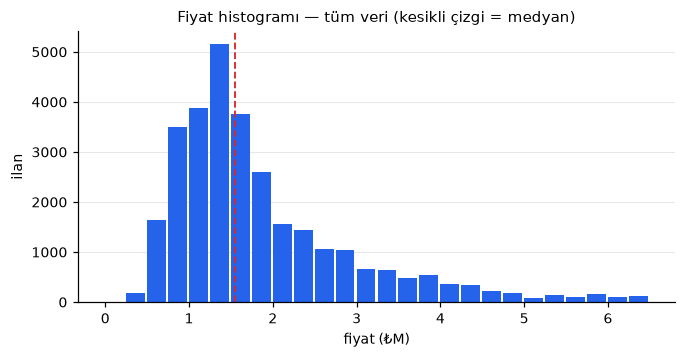

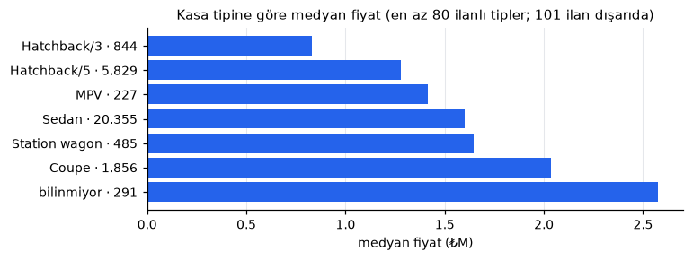

## 5. Piyasa yapısı — belirgin küme yok

Veride belirgin doğal küme yok: standartlaştırılmış sayısal özniteliklerde KMeans, denenen yedi k değerinin (2–8) hepsinde silhouette 0.25'in altında kalıyor (en yüksek k=2, 0.242). Kümeler ve PCA bu yüzden analizde kullanılmadı; piyasa yapısı segment ve kasa tipi gibi açık özniteliklerle okunuyor.

## 6. Hedonik regresyon: kimlik ve durum

Bu bölüm iki soruyu yanıtlıyor. Birincisi: log fiyatın ne kadarı aracın ne olduğu bilinmeden yalnız durumundan, ne kadarı yalnız kimliğinden (araç modelinin adı), ne kadarı ikisinden birlikte açıklanıyor. İkincisi: aracın kimliği sabitken durumu fiyatla nasıl ilişkili ve her etki kimlik sabitlenince nasıl değişiyor. Yöntem hedonik regresyon (OLS; hedef log fiyat, n **29.554**). Burada fiyat tahmini için değil, ikinci soru için kullanılıyor; fiyatı tahmin etmek §7'deki tahmin modelinin işi.

**Not:** Hedonik regresyon bir OLS'tir ve eksik değerlerle çalışamaz; bu yüzden eksik motor gücü (426) ve eksik motor hacmi (356) bulunan ilanlar analiz öncesinde elenmiştir. Her iki alanın da ortak eksik olduğu satırlar düşüldüğünde veri setinden toplam 434 satır çıkarılmıştır.

### Fiyatı ne açıklıyor

Altı regresyon, aynı 29.554 ilanda. R² log fiyatta ve kat dışı: ilanlar katlara bölündü, her katın ilanları öteki katlarda kurulan regresyonla tahmin edildi. Son satır tahmin modelinin aynı ölçekteki kat dışı R²'si.

| regresyon | sütun (sabit dahil) | R² (kat dışı) |
|---|---:|---:|
| yalnız segment, marka, yakıt, vites | 12 | 0.3785 |
| yalnız araç modelinin adı | 735 | 0.8220 |
| yalnız durum: yaş, km, ağır hasar, boyalı ve değişen panel | 9 | 0.7309 |
| durum + motor gücü ve hacmi | 11 | 0.8719 |
| durum + motor + segment, marka, yakıt, vites (**segment kontrolü**) | 22 | 0.9310 |
| segment kontrolü + araç modelinin adı (**araç modeli kontrolü**) | 756 | 0.9610 |
| **tahmin modeli** (LightGBM) | – | 0.9699 |

Yalnız durumla R² 0.7309, yalnız araç modelinin adıyla 0.8220, ikisi birlikte (araç modeli kontrolü; motor ve öteki kimlik kuklaları dahil) 0.9610. Yalnız durumun kattığı (araç modeli kontrolü eksi yalnız araç modelinin adı) 0.1390, yalnız aracın kimliğinin kattığı (araç modeli kontrolü eksi yalnız durum; motor burada kimlik tarafında) 0.2301; kalan 0.5919 ortak: durum ve kimlik birbirinden bağımsız değil, bu kısmı ikisinden biri tek başına da açıklıyor.

Araç modelinin adı, segment kontrolünden tahmin modeline kalan farkın (0.9310 → 0.9699) yaklaşık %77 kadarını kapatıyor (0.9310 → 0.9610). Tahmin modelinin R²'si 29.988 ilanın tamamında, regresyonlarınki motor değeri olan 29.554 ilanda. Örneklem içi R² en çok yalnız araç modelinin adında kat dışından yüksek (0.8475): az ilanlı araç modellerinde kukla kendi ilanlarına uyuyor, görmediği ilanda o kadar tutmuyor; tablo bu yüzden kat dışı R²'yi veriyor. Tahmin modelinin başlıktaki R²'si (0.9745) ham ₺ ölçeğinde; regresyonlarla o karşılaştırılmamalı.

### Kimlik sabitken etkiler

Aynı on terim üç sütunda. **Kimlik yok:** yalnız terimler. **Segment kontrolü:** segment, marka, yakıt ve vites kuklaları eklenir. **Araç modeli kontrolü:** bunlara araç modelinin adı eklenir (735 araç modeli), yani her etki aynı araç modeli içinde ölçülür. Aralıklar araç modeline göre kümeli standart hatalardan (aşağıda).

| terim | kimlik yok [%95 GA] | segment kontrolü [%95 GA] | araç modeli kontrolü [%95 GA] |
|---|---:|---:|---:|
| yaş | -%7.04 [-%7.62, -%6.46] | -%6.64 [-%6.92, -%6.37] | -%5.80 [-%6.33, -%5.27] |
| yaş² | +%0.03 [-%0.05, +%0.11] | +%0.08 [+%0.04, +%0.13] | +%0.03 [-%0.03, +%0.08] |
| km (100 bin) | -%10.16 [-%11.88, -%8.41] | -%15.11 [-%15.81, -%14.40] | -%14.83 [-%15.31, -%14.34] |
| km² | +%1.15 [+%0.58, +%1.71] | +%1.56 [+%1.08, +%2.05] | +%1.67 [+%1.34, +%2.01] |
| yaş×km | -%0.39 [-%0.73, -%0.05] | -%0.62 [-%0.89, -%0.35] | -%0.33 [-%0.56, -%0.10] |
| ağır hasar | -%12.83 [-%13.84, -%11.81] | -%11.60 [-%12.51, -%10.68] | -%12.46 [-%13.25, -%11.67] |
| boyalı | -%1.21 [-%1.37, -%1.06] | -%1.05 [-%1.17, -%0.92] | -%0.98 [-%1.09, -%0.88] |
| değişen | -%3.53 [-%3.84, -%3.22] | -%3.06 [-%3.33, -%2.79] | -%3.12 [-%3.35, -%2.88] |
| +100 hp | +%50.15 [+%39.36, +%61.78] | +%19.86 [+%13.89, +%26.15] | +%19.30 [+%6.90, +%33.12] |
| +1 litre | +%11.66 [+%1.72, +%22.57] | +%7.49 [+%0.71, +%14.73] | +%5.97 [-%0.92, +%13.35] |

Etki = exp(β)−1. Yaş ve km **medyan araca** (11 yaş, 181.000 km) ortalandı: yaş ve km satırları o araçtaki marjinal etki. Kare ve etkileşim terimleri (yaş², km², yaş×km) tek başına okunmaz; eğrinin bükülmesini taşır. Segment ve araç modeli kontrolü sütunlarının farkı her terim için araç modeline göre kümeli bir testle sınandı: fark yaş, yaş×km, ağır hasar, boyalı terimlerinde örnekleme hatasından büyük (%5 düzeyinde); öteki terimlerde değil. Karar notundaki km, ağır hasar ve değişen panel etkileri araç modeli kontrolü sütunundan; yaş ve boyalı panel aşağıdaki iki tablodan, onlar da aynı araç modeli içinde.

Kimlik sabitlenince en belirgin değişen iki terim km ve +100 hp: yalnız bu ikisinde kimliksiz sütunun aralığı öteki iki sütunun hiçbiriyle örtüşmüyor. **Km** kimlik olmadan çok daha zayıf görünüyor: km (100 bin) kimlik yokken -%10.16 [-%11.88, -%8.41], araç modeli içinde -%14.83 [-%15.31, -%14.34]. Km ile aracın kimliği birlikte değişiyor: yaşı, hasarı ve motoru aynı ilanlar arasında km'si yüksek olanlar ortalamada fiyatı daha yüksek araç modellerinden. Kimliksiz katsayı bunu da taşıdığı için km'nin fiyatla ilişkisini küçük gösteriyor. **+100 hp** ise kimlik olmadan çok daha büyük: +%50.15 [+%39.36, +%61.78]; segment kontrolünde +%19.86 [+%13.89, +%26.15], araç modeli kontrolünde +%19.30 [+%6.90, +%33.12]. Log ölçekte kimliksiz etkinin yarıdan fazlası segment, marka, yakıt ve vites girince gidiyor: büyük kısmı motorun kendisi değil, aracın sınıfı. Kimliksiz sütunla öteki ikisi arasında terim başına bir fark testi yok; bu iki gözlem aralıkların örtüşmemesine dayanıyor.

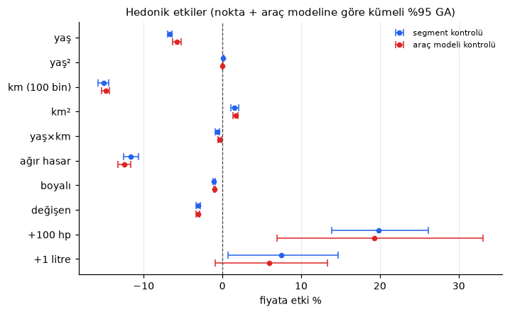

**Güven aralıkları.** Aynı araç modelinin ilanları birbirinden bağımsız değil ve hata varyansı eşit değil (Breusch-Pagan p <0.001); bu yüzden %95 güven aralıkları araç modeline göre kümelenmiş standart hatalardan (735 küme). Aralığı sıfırı içeren terimler: kimliksiz sütunda yaş²; segment kontrolünde yok; araç modeli kontrolünde yaş², +1 litre. Duyarlılık: seriye göre kümelenince (22 küme; az ve dengesiz, bu yüzden yalnız karşılaştırma için) aralığı sıfırı içeren terimler segment kontrolünde +1 litre, araç modeli kontrolünde yaş², yaş×km, +1 litre. Aynı serinin araç modelleri de birbirinden bağımsız değil; bu terimlerin anlamlılığı kümelemenin seçimine bağlı.

**Katsayılar nedensel etki değil, kontrollü ilişkidir.** Ör. boyalı panelin katsayısı boyamanın fiyatı düşürdüğünü değil, boyalı panelli ilanların benzerlerinden o kadar ucuz ilan edildiğini söyler.

**Çoklu bağlantı.** Segment kontrolü sütununun tasarımında en yüksek VIF yaş×km 7.25 (10'un altında); ortalanmamış tasarımda en yüksek yaş×km 96.28. Yaş, yaş², km, km² ve yaş×km aynı iki değişkenden türediği için yapısal olarak bağlı; medyan araca ortalamak bunu giderir, tahminler ve R² değişmez.

### Yaş: yıllık basamaklar

Yaş burada ikinci dereceden bir terim yerine yaş başına bir kuklayla, km esnek bir eğriyle (B-spline, 6 serbestlik derecesi) giriyor; öteki terimler ve araç modeli kontrolü aynı. Tablo iki yaş arasında yıl başına ortalama fiyat değişimini veriyor.

| yaş | aradaki ilan | yıl başına [%95 GA] |
|---|---:|---:|
| 1–5 | 4.812 | -%5.51 [-%6.73, -%4.28] |
| 5–10 | 9.430 | -%6.82 [-%7.81, -%5.83] |
| 10–15 | 15.533 | -%6.14 [-%7.32, -%4.94] |
| 15–20 | 5.204 | -%4.69 [-%6.06, -%3.31] |

İkinci dereceden terim medyan araçta (11 yaş) tek bir sayı veriyor: yılda -%5.80 [-%6.33, -%5.27]. Yıllık basamaklarla düşüş yaşa göre yılda %4.69 ile %6.82 arasında (en dik 5–10, en yavaş 15–20 yaş arası); basamakların 2/4 tanesi o tek sayının aralığının dışında. Tek sayı seçilen fonksiyon biçimine bağlı; yaşa göre değişen bir düşüşü tek orana indiriyor. Veri tek dönem (Ocak–Haziran 2026): ölçülen, aynı dönemde ilanda olan ve bir model yılı farklı araçların fiyat farkı; bir aracın yaşlanırken ne kadar değer kaybettiği değil.

### Boyalı ve değişen panel sayısı

Burada boyalı (değişen) panel sayısı doğrusal bir terim yerine sayı başına bir kuklayla giriyor; etki hiç boyalı (değişen) paneli olmayan ilanlara göre, aynı araç modeli içinde, öteki terimler sabitken. Son satır 5 ve fazlası.

| panel sayısı | boyalı: ilan | boyalı [%95 GA] | değişen: ilan | değişen [%95 GA] |
|---|---:|---:|---:|---:|
| 1 | 4.050 | -%2.29 [-%2.62, -%1.96] | 4.638 | -%3.70 [-%4.03, -%3.37] |
| 2 | 2.978 | -%3.57 [-%3.99, -%3.15] | 2.276 | -%6.38 [-%6.93, -%5.83] |
| 3 | 2.022 | -%4.21 [-%4.74, -%3.67] | 856 | -%9.32 [-%10.09, -%8.54] |
| 4 | 1.439 | -%5.18 [-%5.77, -%4.59] | 258 | -%11.72 [-%13.23, -%10.19] |
| 5 ve fazlası | 2.867 | -%7.01 [-%7.65, -%6.37] | 82 | -%11.05 [-%15.33, -%6.55] |

**Boyalı panel her biri sabit bir tutar değil.** Tek boyalı panel -%2.29 [-%2.62, -%1.96]; doğrusal terimin panel başına katsayısı -%0.98 [-%1.09, -%0.88] ve iki aralık örtüşmüyor. 5 ve fazlası -%7.01 [-%7.65, -%6.37]: ilk panelin etkisi her panelde tekrarlansaydı 5 panel -%10.94 olurdu, aralık bunu da dışlıyor. İlk boyalı panel en çok düşürüyor, sonrakiler ortalamada daha az. **Değişen panel doğrusala yakın:** panel başına -%3.12, panel sayısıyla katlanınca 2'den 5 ve fazlasına kadar her satırın aralığına düşüyor; yalnız ilk değişen panel (-%3.70 [-%4.03, -%3.37]) bundan fazla düşürüyor.

### Motor etkisi

+100 hp segment kontrolünde **+%19.9**, araç modeli kontrolünde **+%19.3**; +1 litre **+%7.5** ile **+%6.0** (aynı regresyonda, diğeri sabitken). Araç modelinin adı motoru büyük ölçüde belirlediği için araç modeli kontrolünde motor terimleri yalnız aynı araç modeli içindeki güç ve hacim farkından ölçülür; aralıkları bu yüzden daha geniş. Bu fark ince: araç modellerinin yalnız 354/735 tanesinde güç ilanlar arasında değişiyor (araç modeli içi standart sapma 9.0 hp, genelde 43.1 hp) ve bir kısmı katalog hatası: §8'in motor değeri tutarsız ilanları çıkarılınca (15 ilandan 14 tanesi hedonik örneklemde; kalan 1 ilan geçerli motor gücü ya da hacmi olmadığı için örneklemde hiç yer almıyor) araç modeli kontrolünde +100 hp +%19.3 → +%26.0. Hacim ve güç birbirine bağlı (Pearson korelasyonu 0.73): hacmin etkisi güç sabitken kalan kısım, iki katsayı birlikte okunmalı; birimler farklı olduğu için doğrudan kıyaslanmaz.

### LOFO — çıkarma testi

LOFO ikinci ve bağımsız bir yöntem: her özniteliği çıkarıp CV hatasının ne kadar büyüdüğüne bakar. SHAP'tan farklı bir şeyi ölçer — öznitelik yokken geri kalanların telafi edemediği kısmı. Sıralama SHAP'la örtüşmüyor: LOFO'da Kilometre > Yaş (yıl) > hasar grubu > model/seri adı > motor (hp + cc); SHAP'ta Yaş (yıl) > motor (hp + cc) > Kilometre > model/seri adı > hasar grubu. En keskin fark motor (hp + cc): SHAP'ta 2. sırada, LOFO'da 5. (ΔRMSE ₺524) — çıkarılınca tahmin modeli onu büyük ölçüde başka özniteliklerden telafi ediyor.

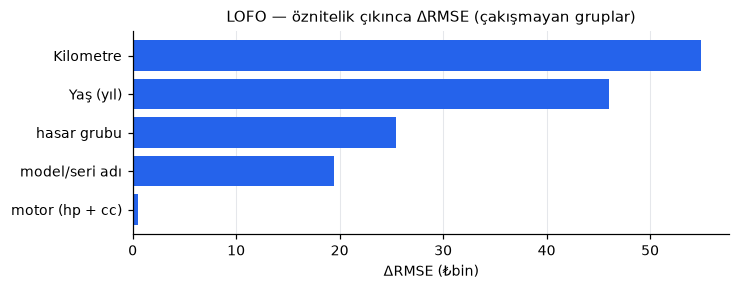

Grafik 5 çubuk gösteriyor, tahmin modeli 25 öznitelik kullanıyor: 19 öznitelik ölçüldü (2'si kendi çubuğunda, 17'si 3 grubun içinde: `DAMAGE_COLS` · `MODEL_SERIES` · `ENGINE`); **6 öznitelik hiç ölçülmedi**: `brand` · `kb_body_type` · `kb_drivetrain` · `segment` · `kb_transmission` · `kb_fuel`.

## 7. Model karşılaştırma ve kısıtlar

Rapordaki tahmin modeli: **LightGBM (model/seri adı TF-IDF+SVD)** — MAPE **%6.49**, R² **0.9745**, MAE **₺110K**. Hedef `log1p(price)`, 25 öznitelik. Emsal medyanı tabanına (aynı araç modeli ve yıl; emsal yoksa daha geniş medyan) göre ortalama mutlak hatada (MAE) %43 daha iyi.

**TF-IDF+SVD neye uygulanıyor.** Serbest ilan metnine değil, yalnız `model` ve `series` ad dizgilerine ("A4 Sedan 2.0 TDI" gibi). Amaç, nadir ad kombinasyonlarının isim benzerliği üzerinden komşularından bilgi ödünç almasıdır; target encoding'in seyrek hücrelerde zayıfladığı yeri kapatır. Satıcı açıklaması modele hiçbir biçimde girmez (bkz. §1, üçüncü katman).

### Model varyantları

| varyant | MAPE | R² | MAE | MedAE | RMSE |
|---|---:|---:|---:|---:|---:|
| LightGBM (model/seri adı TF-IDF+SVD) | %6.49 | 0.9745 | ₺109.776 | ₺75.320 | ₺176.225 |
| CatBoost (model/seri adı TF-IDF+SVD) ★ | %6.44 | 0.9745 | ₺110.085 | ₺74.927 | ₺176.130 |
| CatBoost (model/seri adı native text) | %6.58 | 0.9739 | ₺112.925 | ₺77.660 | ₺178.312 |
| emsal medyanı (taban, merdivenli) | %11.20 | 0.9235 | ₺191.224 | ₺130.000 | ₺305.050 |

★ = yalnız MAPE'ye bakan kuralın kazananı: **CatBoost (model/seri adı TF-IDF+SVD)**. Ama iki TF-IDF+SVD varyantı arasındaki fark 0.05 MAPE puanı ve ₺309 MAE; LightGBM şu metriklerde önde: MAE; CatBoost şunlarda: MAPE, MedAE, RMSE → pratikte **eşitler**. Rapor boyunca "model" LightGBM'dir: CPU'da deterministik, CatBoost'un ağaçları ise cihaza (GPU/CPU) göre değişir — önceki bir GPU koşumunda MAPE sırası tersti. Conformal aralık ve marka ablasyonu LightGBM'den.

### Taban basamak kırılımı

| basamak | ilan | pay | MAPE | MAE | R² |
|---|---:|---:|---:|---:|---:|
| araç modeli + yıl | 29.236 | %97.49 | %10.69 | ₺179K | 0.9450 |
| araç modeli | 596 | %1.99 | %26.70 | ₺559K | 0.6082 |
| global | 156 | %0.52 | %47.38 | ₺1.10M | -0.2359 |

Merdiven: (model, yıl) medyanı → (model) medyanı — tüm yıllar → global medyan. Test'teki (araç modeli, yıl) hücresi eğitim fold'unda yoksa taban bir alt basamağa iner; her inişte hata belirgin büyür — emsalsiz araçta taban zaten zayıf. Medyanlar her fold'da yalnız eğitim kısmından hesaplanır (sızıntısız, tahmin modeliyle aynı 5-fold). Basamak adlarındaki "model" araç modelidir (verideki `model` kolonu), tahmin modeli değil.

**Model Kısıtları ve Gözlemler.** Modifiye, özel donanım veya ÖTV muafiyeti gibi form alanlarında yer almayıp serbest metne gizlenen bilgiler modele girmiyor; metninde dönüşüm ya da modifiye ifadesi geçen ilanlarda büyük hata oranı ham olarak %4.9, diğerlerinde %3.9; yaş, km, fiyat, performans ailesi, emsal sayısı ve marka sabitken olasılık oranı 1.14 (%95 GA 0.94–1.37): anlamlı bir fark ölçülmedi. Bu ifade performans ailelerindeki ilanların %43.6 kadarında geçiyor. Emsali olmayan ilanlarda hata belirgin şekilde büyüyor: aynı model ve yıldan başka ilan yoksa büyük hata oranı %19.0, 100+ emsal varsa %2.9; lira ölçeğindeki en büyük hatalar da bu uçta (§8). Kapsamlı bir hiperparametre optimizasyonuna bilinçli olarak gidilmedi; getirisi bu raporda ölçülmedi. Model zamanı görmez: dört taramanın fiyatlarını birlikte öğrenir ve yukarıdaki hatalar taramaları karıştıran 5-fold OOF'tan; son taramada yeni ilanlardaki hata §8'de.

Servis edilen LightGBM bütün ilanlarla, CV'de erken durdurmanın seçtiği ağaç sayılarının medyanıyla (258 ağaç) eğitiliyor; yani yukarıdaki ölçümle aynı ayarda.

Servis paketi aralığı da taşıyor: ölçek modeli (s), katsayı k = 2.087, isabet olasılığı için 29.988 sıralı skor ve emsal tablosu (eğitimdeki 2.194 (model, yaş) hücresinin ilan sayısı); verinin son tarama tarihi 2026-06-27. Aralık ve isabet olasılığı istek anında bu parçalarla, §8'deki tarifle hesaplanıyor. Paketten servis edildiği gibi üç örnek:

| örnek | tahmin | emsal | aralık | isabet olasılığı | sitede |
|---|---:|---:|---:|---:|---:|
| bol emsalli, tahmini en yüksek ilan | ₺4.82M | 117 | −%9.2 / +%10.1 | %89.6 | 10'da 8 |
| aynı araç, modelinin eğitimde olmadığı bir yaşta | ₺2.29M | 0 | −%25.5 / +%34.3 | %42.9 | 10'da 4 |
| aynı araç, model adının son harfi eksik | ₺4.67M | 0 | −%16.2 / +%19.3 | %65.1 | 10'da 6 |

Emsal, model adı eğitimdeki dizeyle birebir aranarak bulunur: yazım hatası emsali 0 yapar ve aralığı genişletir (−%9.2 / +%10.1 yerine −%16.2 / +%19.3). İhtiyatlı yönde bir hata, ama sebebi kullanıcıya görünmeli.

## 8. Kalibrasyon, artıklar ve zayıflık

OOF (sızıntısız) tahminler gerçek fiyata karşı — R² **0.9745**. Artık% ortalamada sıfıra yakın (ort. -%0.47, std %9.27). Tahmin edilen fiyatın her düzeyinde de: gerçek fiyatın tahmine göre eğimi **1.003**, tahmin çeyreklerinde ortalama sapma −₺12K ile −₺3K arasında.

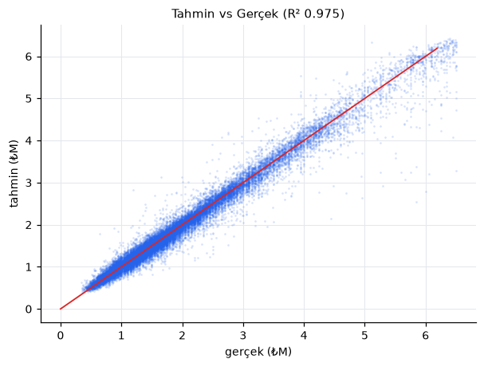

### Hata dağılımı

| \|hata\| bandı | ilan | pay |
|---|---:|---:|
| ≤ %5 | 15.775 | %52.6 |
| %5 – %10 | 8.221 | %27.4 |
| %10 – %20 | 4.784 | %16.0 |
| > %20 | 1.208 | %4.0 |

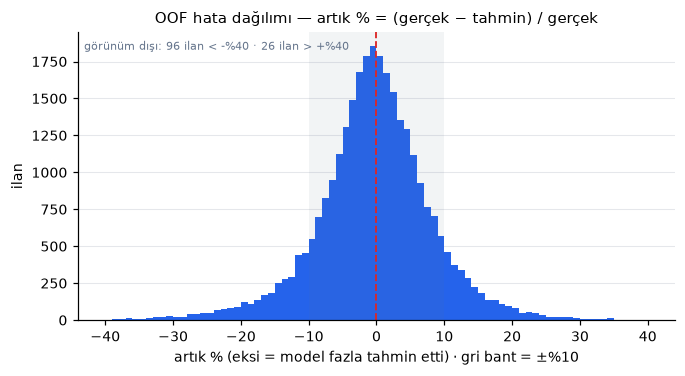

Tüm 29.988 ilanın OOF hatası. Dağılım sıfırda tepe yapıyor (medyan artık -%0.27); ±%10 içinde kalan ilan payı **%80.0**. Ortalama |hata| %6.5 — MAPE'nin kendisi; medyan |hata| %4.7. Yüzde artıkta kuyruk asimetrik görünüyor: model gerçeğin %20'den fazla **üstünü** 768 ilanda, **altını** 440 ilanda söylüyor (en uçlar -%178.1 ve +%56.5). Bunun tamamı tanımdan: artık gerçek fiyata bölündüğü için düşük tahmin en fazla %100 olabilir, fazla tahminin sınırı yoktur. Simetrik ölçekte (bir taraf ötekinin 1.2 katından büyük) fazla tahmin 768, düşük tahmin 812 ilan — asimetri tersine dönüyor. Std (%9.27) bu kuyruk yüzünden şişik; tipik hatayı medyan |hata| daha iyi anlatır.

### Büyük hatalar nereden geliyor

Hatası ±%20 sınırını aşan 1.208 ilan (768 fazla, 440 düşük tahmin). Aşağıdaki kırılımlar yalnız yapısal alanlardan sayılır — metin dedektörüne dayanmaz.

| aynı model+yılda ilan | ilan | büyük hata | fazla tahmin | düşük tahmin |
|---|---:|---:|---:|---:|
| 1 | 610 | %19.0 | %10.7 | %8.4 |
| 2–4 | 1.584 | %10.5 | %6.2 | %4.3 |
| 5–19 | 5.732 | %4.7 | %3.0 | %1.7 |
| 20–99 | 16.505 | %3.0 | %1.9 | %1.1 |
| 100+ | 5.557 | %2.9 | %2.0 | %0.9 |

1. **Emsal yok.** Aynı model ve yıldan başka ilan yoksa büyük hata oranı %19.0, 100+ emsal varsa %2.9.
2. **Uç ya da yaşlı araç.** F/S segmentte %19.1 — ama o iki segmentte toplam 444 ilan var (F 325 · S 119), yani en riskli işaretlenen yer aynı zamanda en ince olanı. Diğerleri %3.8; yaş ≥ 18'de %12.0 (daha gençlerde %3.2).

**18 yaş verinin seçtiği bir eşik değil.** Büyük hata oranı yaşla artıyor: 5 yaş %0.35 · 10 yaş %1.56 · 15 yaş %7.86 · 18 yaş %11.69 · 21 yaş %15.34. En büyük bir yıllık sıçrama 16→17 yaş arasında (%7.79 → %12.72). Kesim 8 ile 21 arasında kaydırılınca yaşlı/genç oranı 3.5–6.7 kat arasında kalıyor; 18'de 3.7 kat. Ayrıca en yaşlı kova toplama sınırına dayanıyor: veri 2005 model yılıyla başlıyor, yani 18 ve üstü kovada yalnız 4 model yılı var.

İlişki; ilan ilan doğrulanmadı. Formda olmayan bilgi (hasar geçmişi, donanım, modifiye) olası katkı, burada ölçülmedi.

#### Örnekler

| araç | yıl | km | fiyat | model tahmini | artık |
|---|---:|---:|---:|---:|---:|
| BMW 640i | 2011 | 160.000 | ₺5.600.000 | ₺3.236.953 | +%42.2 |
| Audi 4.2 FSI Quattro R-tronic (R8) | 2008 | 112.550 | ₺4.690.000 | ₺2.744.815 | +%41.5 |
| BMW 750i Long | 2007 | 271.000 | ₺1.190.000 | ₺2.831.842 | -%138.0 |

- **BMW 640i · 2011:** İlan metnine göre araç komple M6 dönüşümü: M6 motoru ve M6 kasa parçaları takılmış. Form hâlâ 640i dediği için model onu sıradan bir 640i gibi fiyatlıyor; alıcı ise bir M6'ya bakıyor.
- **Audi 4.2 FSI Quattro R-tronic (R8) · 2008:** Veride tek R8. Formdaki model adı yalnız "4.2 FSI Quattro R-tronic"; aynı motor adını taşıyan S5 4.2 FSI Quattro'ların medyanı ₺2.62M (4 ilan) ve model tahmini buna yakın. Emsali olmayan bir süper otomobili model, adı benzeyen S5 gibi fiyatlamış.
- **BMW 750i Long · 2007:** Veride bu addan 2 ilan var; diğeri ₺5.30M'lik dönüşümlü bir 2009 araç. Bu ilan ise aynı yılın 730d'leriyle (15 ilan, medyan ₺1.18M) uyumlu ve metni bakımlı, masrafsız diyor. İlan piyasaya uygun, yanılan model: emsali olmadığı için muhtemelen adın diğer, pahalı ilanından etkileniyor.

Tahminler OOF; ilan kimliği (`ad_id`) bilerek yazılmadı.

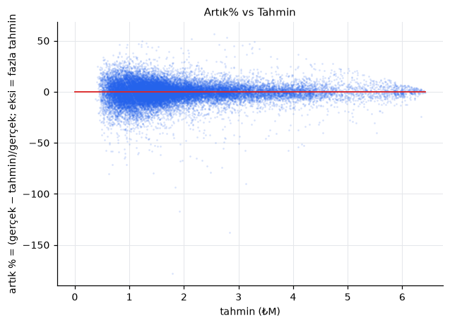

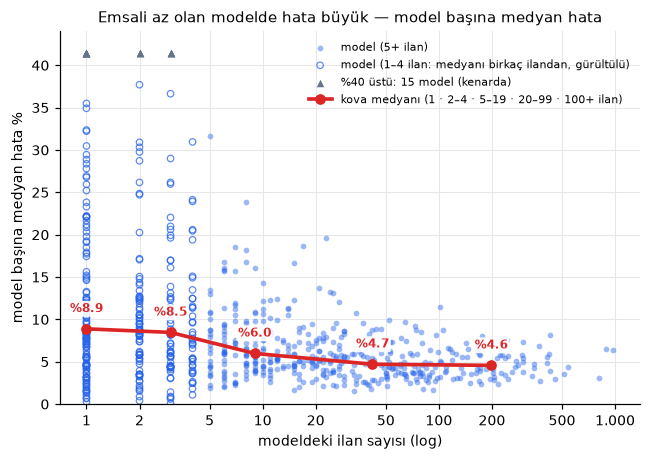

Her nokta bir model; y ekseni o modelin ilanlarındaki medyan hata. Kova medyanı tek ilanlı modellerde %8.9, 100+ ilanlıda %4.6. Yukarıdaki tablo iki yönden farklı ölçer: büyük hata **oranını** sayar ve ilanları model+**yıl** bazında gruplar. İkisi aynı yönü gösteriyor — emsal azaldıkça hata büyüyor.

### Conformal aralık ve kapsama

**Conformal aralık**, modelin tek bir fiyatın yanında veriye dayalı bir fiyat bandı da sunmasıdır. Servis edilen aralık araca göre değişir: bütün ilanların medyan tahmini ve medyan payıyla ₺1.36M – ₺1.73M.

- **Dağılım varsayımı yapmaz:** Hataların bir formüle (çan eğrisi vb.) uyduğu varsayılmaz. Modelin daha önce hiç görmediği araçlardaki gerçek hatalar, o tür araçta beklenen hata büyüklüğüne bölünüp sıralanır; en kötü %10'u dışarıda bırakılır ve katsayı (k = 2.087) doğrudan veriden okunur. Tek varsayım, yeni ilanların eskilere benzemesidir; son taramanın yeni ilanlarında ne kadar tuttuğu aşağıda.
- **Araca göre ve oransal:** Küçük bir ikinci model (ölçek modeli, s) aracın formdaki bilgilerinden, fiyat tahmininden ve emsal sayısından (eğitimde aynı model ve yıldaki ilan sayısı) bu tür araçta beklenen log hata büyüklüğünü tahmin eder; aralık log tahmin ± k·s. Pay yüzde olarak uygulanır: medyan araçta −%11.6 / +%13.1, %5'lik yüzdelikte −%7.0 / +%7.5, %99'lukta −%28.5 / +%39.8. Genişlik en dar %8.9, %99'luk yüzdelikte %68.3; ilanların %62.4 kadarında aralık tek paydan dar. s, emsal arttıkça büyümeyecek biçimde kısıtlı (ortalama s, emsal sayısı 0 iken 0.093, 200 iken 0.060) ve alttan 0.02 ile kırpılır; bu alt sınır OOF'ta hiçbir ilanda devreye girmiyor, yeni ilanlarda 8.889 ilanın 2 tanesinde giriyor.
- **%90 yaklaşık ve aynı dönem için:** %90 tasarım gereği yaklaşık tutar: her katın aralığı yalnız öteki katların hatalarından kurulduğu ölçümde kapsama %90.09 (aşağıdaki tablo). Bu yalnız aynı dönemin ilanları için geçerli, zaman içinde değil: son taramanın yeni ilanlarında %86.8 (aşağıda). Sayılar Ocak–Haziran 2026 ilan fiyatlarını anlatır; son taramanın (2026-06-27) 11.526 ilanında kapsama tek payla %88.7, ölçek modeliyle %88.9.

**Zayıflık yaşa ve emsale bağlı** (yukarıdaki kırılımlar); fiyata göre bakınca da görünüyor: medyan hata tahmini en ucuz çeyrekte %6.95, en pahalıda %3.55. Herkese aynı yüzde uygulanınca, modelin oransal olarak daha çok yanıldığı ucuz bantta aralık dar kalıyor: Q1 kapsaması %81.0.

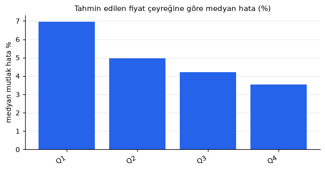

Liraya çevrilince tablo değişiyor: toplam lira hatasının %38.9 kadarı tahmini en pahalı çeyrekte, %17.6 kadarı en ucuzda; ortalama mutlak hata ₺171K ile ₺77K.

**Üç yöntem, aynı çapraz kalibreli ölçümde** (her katın aralığı yalnız öteki katların hatalarından):

| yöntem | kapsama | genişlik medyan / ort. | aralık skoru | emsalsiz (752 ilan) |
|---|---:|---:|---:|---:|
| tek pay (herkese aynı) | %89.99 | %28.3 / %28.3 | 0.4211 | %70.7 |
| banda göre pay | %90.01 | %25.9 / %27.5 | 0.4059 | %66.8 |
| ölçek modeli (servis edilen) | %90.09 | %24.7 / %27.2 | 0.3657 | %90.3 |

Genişlik tahminin yüzdesi. Aralık skoru log uzayında genişlik ile dışarıda kalan fiyatların cezasının toplamı (Winkler); küçük daha iyi. Emsalsiz: aynı model ve yıldan öteki katlarda ilan yok.

**Ölçek modeli neyi değiştiriyor.** Tek pay herkese aynı genişliği veriyor: genç ve pahalı araçta gereğinden geniş, yaşlı, emsalsiz ve hasarlı araçta dar. Ölçek modeli payı araca göre dağıtıyor (aşağıdaki tablo): kapsama 19+ yaşta %75.2 → %88.5, emsalsizde %70.7 → %90.3, ağır hasar kayıtlıda %80.5 → %89.7; 0–3 yaşta %97.4 → %90.8 ve tahmini en pahalı çeyrekte %94.7 → %90.7, çünkü orada aralık daralıyor. Aracın s'ye giren bilgilerine göre gruplarda (yaş, km, motor gücü, segment, yakıt, vites, kasa, hasar, seri sıklığı; en az 200 ilanlı 42 grup) hedeften 5 puan ya da daha fazla sapan grup tek payla 18 (en büyük sapma 25.2 puan), ölçek modeliyle 0 (en büyük 3.5); bu kısmen tasarım gereği, çünkü bu bilgiler s'nin girdisi. s'nin görmediği bilgilerde (satıcı tipi, il, renk, garanti, ilk sahip, takas, hasar kaydı tutarı; 32 grup) düzelme beklenmez: kolun kendi genel kapsamasının 3 puan ya da daha fazla altında kalan grup tek payla 4, ölçek modeliyle 4; ölçek modelinde en kötüsü ilk sahip bilgisinde bir grup (302 ilan, −5.7 puan).

**Takas.** Banda göre payın her fiyat bandında ayrı bir kapsama güvencesi vardı; ölçek modeli bundan vazgeçiyor, bantlardaki kapsaması (%89.6–%90.7) ölçülmüş bir sonuç, güvence değil. Karşılığı araca göre genişlik, daha dar bir medyan aralık ve OOF'ta en iyi aralık skoru. Yöntem, s'nin ayarları, emsal kısıtı ve ±%10 toleransı bu sonuçlar görüldükten sonra kondu; hiçbirinde arama yapılmadı ve seçimi sonradan sınayan bağımsız bir test yok. Kapsama ve isabet ilan fiyatı içindir, satış fiyatı için değil.

**Araç türüne göre (OOF).** Aralık, grubun medyan tahmini etrafında (₺M); isabet, ilan fiyatının tahminin ±%10 yakınında olma olasılığı, öngörülen → gerçekleşen.

| araç türü | ilan | kapsama: tek pay → ölçek | pay: ölçek | aralık: tek pay | aralık: ölçek | isabet |
|---|---:|---:|---:|---:|---:|---:|
| hepsi | 29.988 | %90.0 → %90.1 | −%11.6 / +%13.1 | 1.33–1.77 | 1.36–1.73 | %78.3 → %78.3 |
| 0–3 yaş | 2.649 | %97.4 → %90.8 | −%7.5 / +%8.1 | 3.42–4.53 | 3.64–4.25 | %92.1 → %92.3 |
| 4–7 yaş | 4.420 | %97.5 → %90.5 | −%7.4 / +%8.0 | 2.36–3.13 | 2.52–2.93 | %91.7 → %92.1 |
| 8–12 yaş | 12.264 | %92.7 → %89.9 | −%10.5 / +%11.7 | 1.38–1.83 | 1.42–1.78 | %81.7 → %81.6 |
| 13–18 yaş | 8.853 | %83.3 → %90.3 | −%15.2 / +%17.9 | 0.96–1.27 | 0.94–1.30 | %67.0 → %66.5 |
| 19+ yaş | 1.802 | %75.2 → %88.5 | −%18.1 / +%22.1 | 0.60–0.80 | 0.57–0.85 | %58.5 → %58.9 |
| emsalsiz | 752 | %70.7 → %90.3 | −%19.7 / +%24.6 | 1.49–1.98 | 1.38–2.14 | %53.1 → %55.6 |
| 20+ emsal | 20.081 | %91.9 → %90.3 | −%10.8 / +%12.1 | 1.30–1.73 | 1.34–1.68 | %81.2 → %80.9 |
| tahmini en ucuz çeyrek | 7.497 | %81.0 → %89.9 | −%16.3 / +%19.4 | 0.79–1.04 | 0.76–1.08 | %64.7 → %64.0 |
| tahmini en pahalı çeyrek | 7.497 | %94.7 → %90.7 | −%8.0 / +%8.7 | 2.71–3.59 | 2.87–3.39 | %87.4 → %87.5 |
| km'si en yüksek beşte bir | 5.998 | %79.9 → %89.9 | −%16.5 / +%19.8 | 0.91–1.20 | 0.87–1.25 | %63.5 → %63.0 |
| ağır hasar kayıtlı | 1.407 | %80.5 → %89.7 | −%15.8 / +%18.7 | 1.04–1.38 | 1.01–1.42 | %64.0 → %63.2 |
| F segmenti | 325 | %65.8 → %86.5 | −%21.8 / +%27.9 | 2.30–3.05 | 2.07–3.39 | %49.6 → %51.7 |

**Hata payı banda göre (Mondrian).** Ön kayıtlı ara yol: pay tahmin edilen fiyatın dört çeyreğinde ayrı ayrı hesaplanınca kapsama her bantta %89.96–%90.04. Bedeli genişlik: en ucuz bantta aralık tahminin %28.3 kadarından %37.1 kadarına genişliyor, en pahalıda %21.4 kadarına daralıyor. Ölçek modeli genişliği bant içinde de araca göre veriyor: medyan genişlik en ucuz bantta %35.7, en pahalıda %16.7.

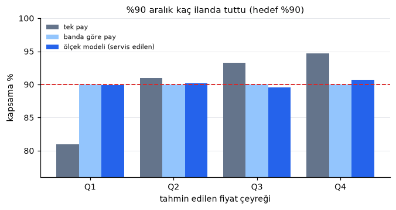

| bant | tahmin edilen fiyat | kapsama: tek pay | kapsama: banda göre | kapsama: ölçek | genişlik: banda göre | genişlik: ölçek |
|---|---|---:|---:|---:|---:|---:|
| Q1 | ₺1.15M altı | %81.0 | %90.0 | %89.9 | %37.1 | %35.7 |
| Q2 | ₺1.15M – ₺1.53M | %91.0 | %90.0 | %90.2 | %27.2 | %25.8 |
| Q3 | ₺1.53M – ₺2.26M | %93.2 | %90.0 | %89.6 | %24.4 | %20.9 |
| Q4 | ₺2.26M üstü | %94.7 | %90.0 | %90.7 | %21.4 | %16.7 |

**Not:** Bantlar tahmin edilen fiyattan kesildi: bir fiyatlama aracının bildiği tek şey o. Gerçek fiyata göre gruplamak ortalamaya dönüş üretir. Genişlik, aralığın alt ve üst ucu arasındaki farkın o banttaki medyanı (tahminin yüzdesi).

**İsabet olasılığı.** Aralıkla aynı hesaptan çıkar, yeni bir model gerekmez: bu tür araçta ilan fiyatının tahminin ±%10 yakınında olma olasılığı, yani skorlardan log(1.1) / s değerine eşit ya da küçük olanların payı. OOF'ta kalibre: ortalama öngörü %78.3, gerçekleşen %78.3; Brier skoru herkese aynı olasılığı veren skordan %12.2 iyi. Araçları ayırıyor: olasılığın 10. yüzdeliği %57.9, 90. yüzdeliği %95.4. Sitede "10'da N" olarak gösterilir: aşağı yuvarlanır ve en çok 9, yani "10'da 10" hiç gösterilmez; 9 görenlerde gerçekleşen %94.2.

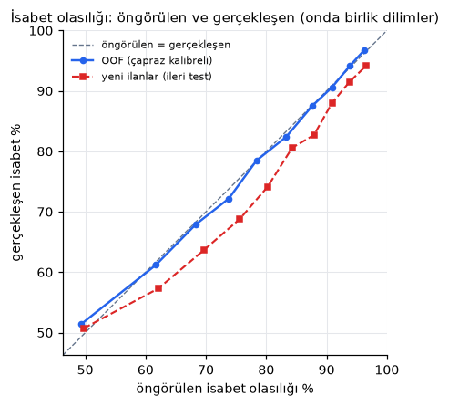

**Yeni ilanlarda: ileri test.** Son taramadan önce görülen 21.099 ilanla eğitilen model (her ilan son fiyatıyla), son taramada (2026-06-27) ilk kez görülen 8.889 ilanı fiyatladı. MAPE %6.78 (%95 aralık %6.42–%7.17); taramaları karıştıran 5-fold OOF'ta %6.49. Servis edilen aralık tarifi aynen uygulandı: q, bant sınırları, s ve k yalnız eğitim ilanlarından (k = 2.100). Kapsama tek payla %87.4, banda göre payla %88.0, ölçek modeliyle **%86.8**: yeni ilanlar için geçerli sayı bu, %90 değil. Aynı model ve yılı eğitimde hiç olmayan 297 ilanda tek pay ve banda göre pay hedefin altında kalıyor, ölçek modeli hedefe yakın (tablo). Kaçırmaların çoğu aralığın üstünde: ölçek modelinde ilanların %10.5 kadarı aralığın üstünde, %2.7 kadarı altında kalıyor. İşaretli hata (log fiyat − log tahmin, ×100) medyanda +2.02, ortalamada +2.46: yeni ilanlar tahminin üstünde kalma eğiliminde. Bu sayı bir fiyat artışı ölçümü değil; bileşenleri bu raporda ayrıştırılmadı.

| yöntem | kapsama | genişlik medyan / ort. | aralık skoru | emsalsiz (297 ilan) | üstte kalan | altta kalan |
|---|---:|---:|---:|---:|---:|---:|
| tek pay (herkese aynı) | %87.4 | %28.2 / %28.2 | 0.4438 | %68.3 | %8.9 | %3.7 |
| banda göre pay | %88.0 | %27.1 / %27.4 | 0.4296 | %65.3 | %8.9 | %3.1 |
| ölçek modeli (servis edilen) | %86.8 | %24.0 / %26.8 | 0.3977 | %88.5 | %10.5 | %2.7 |

Ölçek aralığının genişliğine göre beşte birlerde ölçek modelinin kapsaması %85.3–%89.6 arasında kalıyor; tek pay aynı araçlarda en dar beşte birde %98.0, en geniş beşte birde %70.6 kapsıyor.

**Yalnız seviye (varsayım hesabı, zaman analizi değil).** Bugünkü veride bütün ilan fiyatları %2 / %5 / %10 yüksek olsaydı kapsama tek payla %89.2 / %86.1 / %73.9, ölçek modeliyle %88.6 / %82.3 / %61.6 olurdu; ölçek aralığının en dar beşte birinde %87.0 / %73.6 / %33.7 (bugün %90.5), gerçekleşen isabet %77.1 / %70.6 / %49.4 (bugün %78.3). Dar aralık bir seviye kaymasında kapsamasını önce yitiriyor.

İsabet olasılığı yeni ilanlarda iyimser (yukarıdaki figür): ortalama öngörü %79.1, gerçekleşen %75.1; Brier skoru yine sabit skordan %9.7 iyi; 9 görenlerde gerçekleşen %91.5. Test kümesine bakıp düzeltmek ayar olurdu, yapılmadı.

### En büyük hatalar

**Motor değeri tutarsız ilanlar.** Motor gücü ya da hacmi kendi modelinin medyanından 1.5 kattan fazla sapan 15 ilan var (%0.05): katalog eşleşmesi çökmüş, model aracın sahip olmadığı bir motoru fiyatlıyor; medyan hataları %12.8, geri kalanınki %4.7. Bu kontrol yalnız en az 5 ilanı olan modellerde çalışıyor: daha az ilanlı 307 modelin 632 ilanı (%2.11) onun kör noktası — emsalsizliğin en yoğun olduğu yer.

**Lira ölçeğinde en büyük hatalar.** İlk 100 lira hatasından 73 tanesi düşük, 27 tanesi fazla tahmin. Bu yön bir model eğilimi sayılmaz: gerçek fiyat tahminin etrafında log ölçekte simetrik dağılsaydı da ilk 100'ün ortalama 67.8'i (%95: 60–77) düşük tahmin olurdu; aynı yüzde hata, fiyat tahminin üstündeyken liraca daha büyük. 84 tanesi tahmini en pahalı çeyrekte. Segmentini model adından alan seriler (M Serisi, RS, S, i Serisi) verinin %0.52 kadarı ama ilk 100 içinde 23 ilan — verideki paylarının 44 katı. Fiyat tavanı (₺6.50M) bu uçta modelin öğrendiği aralığı da kesiyor; en pahalı ilanlardaki düşük tahmin bu sınırla birlikte okunmalı.

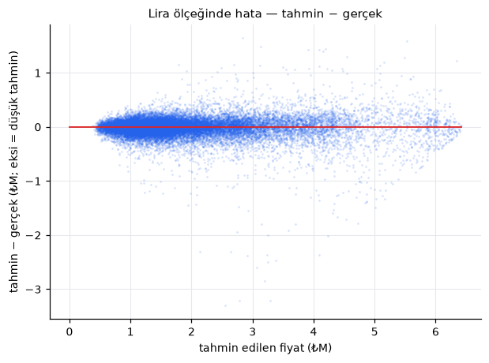

## 9. Serbest metin: ölçüldü, dahil edilmedi

Satıcı açıklaması modele **girmiyor**. Bu bir ihmal değil, ölçüm sonucu: §7'deki model log fiyatta R² **0.9699**; aynı fold'larda açıklama metni eklenince **0.9707** — ΔR² **0.0008**, modelin açıklayamadığı log varyansın %2.6 kadarı. MAPE %6.49 → %6.41, ortalama mutlak hata ₺109.776 → ₺108.770.

Metin kolu modelle aynı öznitelikleri, fold'ları ve LightGBM ayarlarını kullanıyor; açıklama kelime TF-IDF'i (1–2 gram) ve 50 SVD bileşeni olarak ekleniyor, ikisi de her fold'un yalnız eğitim kısmında kuruluyor. Fark ön kayıtlı eşiğin altında (ΔR² < 0.005 ve MAPE iyileşmesi < 0,2 puan), bu yüzden metin modele eklenmedi. Ölçüm her koşuda yeniden yapılıyor; eşik aşılırsa bu bölüm üretilmez.

Metinde dönüşüm, motor değişimi ya da modifiye ifadesi geçen ilanlar ayrıca işaretleniyor: 3.107 ilan (%10.4), §7'deki metin bayrağı. Bayrak düz bir kelime kuralı; kelime listesi arşivlenmiş bir LLM çıkarım denemesinin sözcük dağarcığından damıtıldı ve her koşuda bugünkü metne uygulanıyor.
